# Free Local Agent

**Your AI. Your machine. Your freedom.**

Free Local Agent is an open-source desktop AI agent for chat, coding, research,
and documents. It runs a free model on your own computer, using a bundled
inference engine. You choose the model, the project, and the tools it can use.
File edits and terminal commands wait for your approval.

No hosted model account, API key, subscription, Ollama, or separately installed
model server is required. Model weights are a separate download or local GGUF
import. Once a compatible model is installed, chat and local file work can run
offline.

**Current version: 0.4.0-alpha.4, R9.** R9 clarifies how the Agent reads granted
attachments using their supplied paths while keeping project mutations relative
to the selected workspace. It passed **328/328 automated checks with public
networking denied by macOS**, TypeScript and actual packaged offline smoke.
A fresh native cross-workspace attachment read passed: one completed read,
the exact file text and verified digest in its final answer, and no edits,
commands or approvals.
Fresh R9 Chat also answered only `42` with no tools; a normal quit/relaunch
restored that saved Chat and the 100% text setting.
The regular profile is open again with its original five tasks, workspace and
Qwen ready. A normal preference save migrated it to v4 while preserving chats,
attachments, project paths, six undo records and the model digest. Its separate
short Metal/8K calibration samples measured **11.1 and 11.0 tokens/sec**.

The preceding R8 package updates native file/folder dialogs and restores focus
when a dialog closes. It passed **327/327 automated checks with
public networking denied by macOS**, TypeScript, and an actual packaged offline
smoke check. In a fresh native profile, setup preserved the draft and attachment,
importing the verified Qwen model enabled Send without restarting, and Chat
answered exactly `42` with zero tools; reopening restored that answer. Native
folder creation and screenshot export also passed. Working expanded by mouse,
Enter and Space during a read task that used an incorrect relative path and was
stopped; that task did not complete. A separate request in the correct workspace
completed one read and returned the exact file text and tool-reported digest.
R8's separate short calibration measured **15.2 tokens/sec** on Metal with 8K
context.

The preceding R7 package passed **315/315 automated checks**, **94 Python source
tests**, and **8 frozen-sidecar protocol tests**. Its native Qwen tests passed
CLI repair with four input cases, exact-file work, retained-file readback, and
Chat `42` without tools or approvals. Chat mode and 125% text size survived
reopening. Working expansion was checked by mouse, Enter and Space; calibration
measured **28.9 tokens/sec** on Metal with 8K context.

Gemma 4 26B downloaded and passed integrity verification, but its R7 disk-mode
trial stopped during loading at the sampled memory budget, before Chat/tools.
Returning to Automatic restored Qwen Metal inference. On **2026-10-13**, visible
R7 startup checks confirmed the regular profile's five tasks, workspace and
selected Qwen model, plus empty-profile onboarding with no generic engine error.
Opening and closing model setup retained the empty profile's draft and attachment;
sending stayed disabled without a model. Read-only checks confirmed 5 regular
chats, 6 undo records and the verified Qwen model remain intact. The preview's
unsent draft remains unverified.
The graphical model tests used normal networking. A separate real-Qwen component
check passed Chat and an actual file-tool read with public networking denied by
macOS; full Electron GUI execution under that policy remains unverified. See
the [validation report](docs/alpha4-validation.md) for hashes, genuine
screenshots, retained failures and each check's scope. Windows/Linux native
execution and broader model quality remain unverified.

## What Free Local Agent does

- **Build in Agent mode.** New tasks start in Agent mode. Choose or create a
  workspace, then ask the model to inspect files, build a project, fix code, or
  run checks using the enabled tools. It reports what its tools actually did.
- **Choose Standard or Careful Agent.** The initial new-task default is **Careful
  Agent**, which is instructed to plan, implement, verify, repair observed failures,
  and finish with results or blockers. **Standard Agent** uses the direct workflow.
  Tasks migrated from earlier versions retain Standard behavior. Neither choice
  guarantees that a model will complete a request correctly.
- **Chat locally.** Agent, Read-only research, and Chat modes use the same locally
  stored conversations. Responses come from the model running on your machine;
  tool-capable models stream replies, while chat-only imports return completed replies.
- **Work with a project.** Search selected project files, propose edits, run
  approved terminal commands, and restore file snapshots with per-chat undo.
  New files can be proposed as one reviewed batch of 1–20 files, with up to
  512 KiB of total text and grouped undo. PHP and PHTML files can be read and searched.
- **Choose a workspace folder.** **Add folder** in the sidebar opens an existing
  folder. **Create folder** asks for a name, then opens a native picker for its
  parent folder. Creation never overwrites an existing file or folder; canceling
  the picker creates nothing. Start **New task** to change a saved task's workspace.
- **Expand the work in progress.** Click **Working**, or focus it and press Enter
  or Space, to see the current stage, tool activity, and thinking text supplied
  by the local model. Thinking stays separate from the answer and is saved
  locally with the reply, including partial text from a stopped or failed turn.
  A model that does not emit thinking text is identified as such.
- **Read larger documents gradually.** Text, code, Markdown, and text-based PDFs
  are read in bounded stages and summarized with source references. Progress,
  cancellation, and local read checkpoints help manage longer tasks.
- **Choose a model for this computer.** Hardware detection and model cards explain
  memory fit, quantization, download size, licenses, and tool compatibility.
  Speed/tool-format calibration and **Validate model for tasks** are separate
  checks. Memory controls offer Automatic, Low memory, and an explicit Experimental
  disk trial on macOS Apple Silicon.
- **Control the utilities.** **Tools** controls file reading, **Find files & text**,
  editing, and terminal commands. These local Agent tools work independently of
  the optional research plugin.
- **Add research when needed.** Open **Plugins → Enable Research** for a bundled
  workflow that checks project versions and changing requirements. Separately
  enable **Allow web research** to consult official documentation, release notes,
  and migration guidance. Both settings default off on new installations. The
  agent cites fetched sources, then continues the task using your enabled tools.
- **Use a focused task workspace.** A neutral, Codex-inspired interface places
  saved tasks in a sidebar, the conversation in the center, and the composer at
  the bottom. Mode, workspace, model, and tool controls sit beside your message.
  The light/dark theme preference is remembered locally.
  Conversation text starts at 15 px, navigation at 13 px, and thinking/code at
  14 px. Sidebar **Text size** remembers a local preference from 90% to 125%,
  with 100% as the default.
- **Start without a model.** A new installation offers model download or import.
  **Choose model** keeps your draft and attachments while you finish setup.
  Engine preparation and genuine failures have separate status messages.
  Isolated test profiles identify their separate storage instead of appearing
  to have lost models or chats from your regular profile.

| Mode | Use it for |
| --- | --- |
| Agent | Creating or changing a project, then running approved checks in a selected workspace. Research is an optional plugin; Agent requires a validated tool-capable model. |
| Read-only research | Reading sources and comparing findings. The mode choice appears when Research is enabled; existing saved research tasks remain readable with the plugin off. Web tools require both plugin activation and web permission. |
| Chat | Conversation, writing, and attached-file reading. Project changes and commands require an Agent task. |

## Workspace

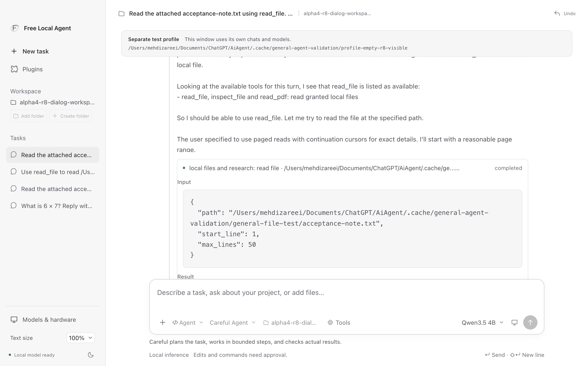

*Actual R9 model thinking and completed read_file input. The supplied absolute
path reads the granted attachment outside the selected workspace. This general
read-only task made one tool call and required no edit or command approval.*

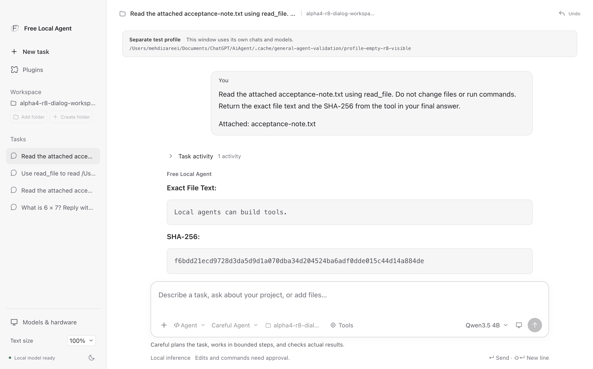

*Actual R9 final answer visibly shows `Local agents can build tools.` and its
verified SHA-256 after that single completed read. The earlier failed R8
attachment attempt remains recorded separately.*

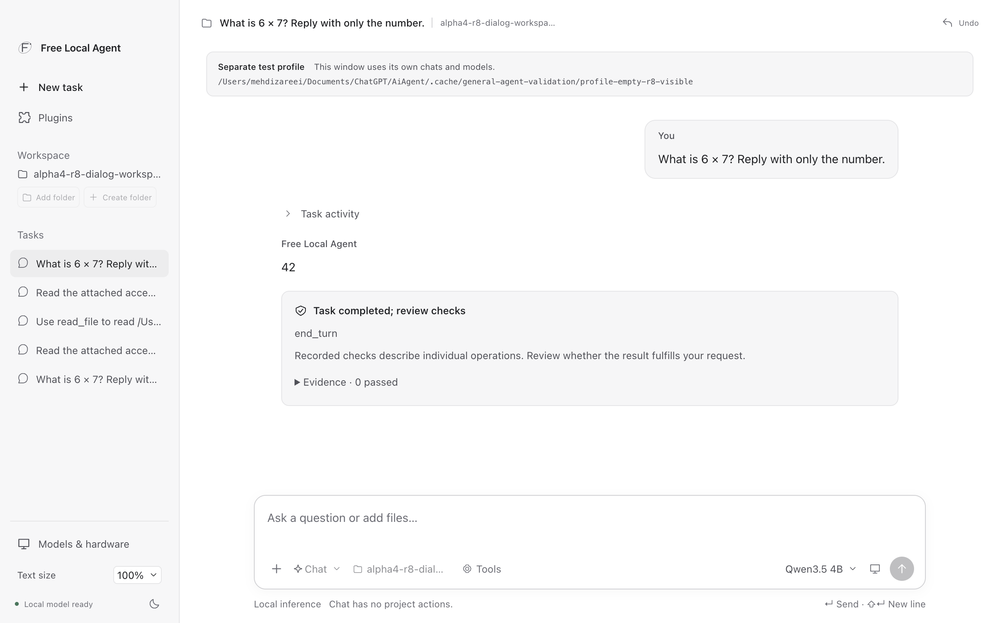

*Actual R9 answer `42`, Chat mode and completed outcome with zero tool checks.
After a normal quit/relaunch, the saved answer, mode and 100% text setting were
visibly restored in the same test profile.*

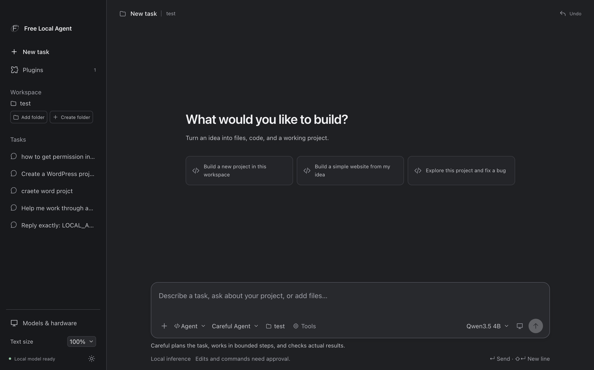

*Actual R9 regular profile after the verified v4 save migration and speed/tool
calibration. Its five original tasks, test workspace, Qwen selection, dark theme,
100% text size and Careful new-task default are retained. The calibration banner
is gone; earlier task and model failures remain in the validation report.*

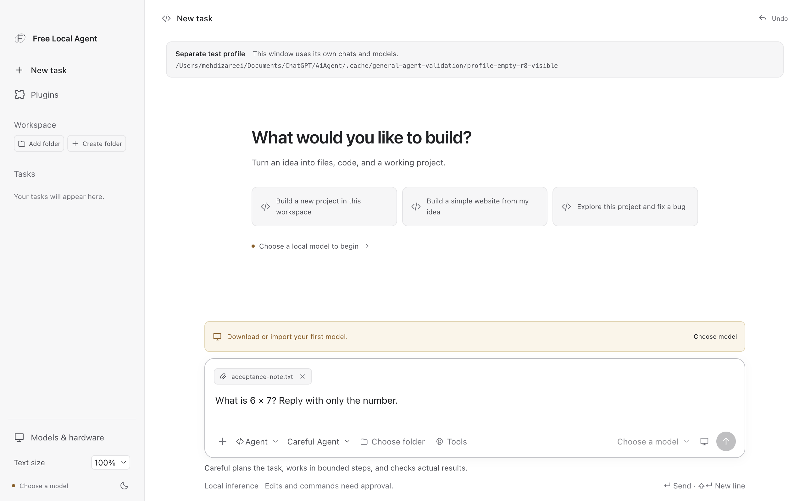

*Actual R8 fresh profile before model import, with its draft and attachment
retained, Choose model available and Send disabled. A normal native file-picker
selection worked, and saving this genuine capture returned focus to the app.*

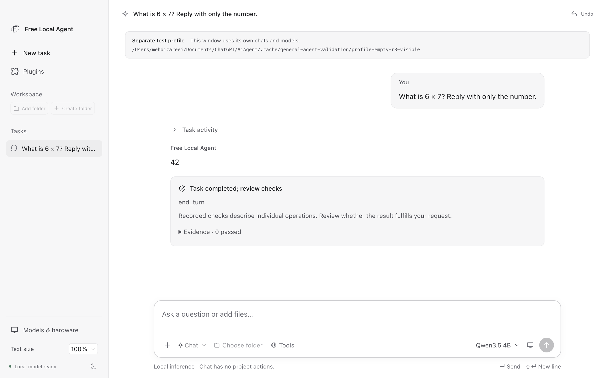

*Actual R8 Chat after importing the verified local Qwen model without restarting.
The exact answer is `42`, with no tool calls or approvals. A normal quit/relaunch
restored the saved Chat and its visible answer.*

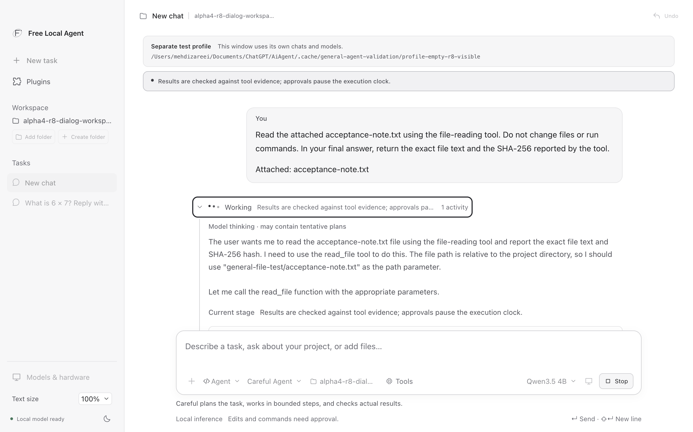

*Actual R8 model thinking with Working expanded. The underlying task chose an
incorrect relative path, repeatedly failed to read it, and was stopped with an
explicit cancelled outcome. Mouse, Enter and Space disclosure checks passed;
this capture does not show successful file readback.*

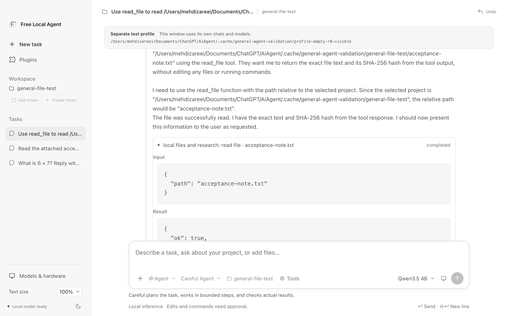

*Actual R8 completed read in the correct workspace, with model thinking and
read_file inputs/results expanded. Its saved final answer contains
`Local agents can build tools.` and the verified digest; no file edits, commands
or approvals occurred. This separate task preserves the earlier failed attempt.*

*Actual final R7 app, ASAR `f01867ce…90b7`, using Qwen3.5 4B in its isolated
validation profile. Working displays real model thinking and retained activities
during a general coding task; mouse, Enter and Space expansion were checked.*

*Actual final R7 answer and recorded checks after one approved edit and one
approved verification command. Independent numeric, empty, malformed and
nonnumeric input checks passed. The final source hash matches the approved edit
and readback; this is evidence for this task, not a universal quality guarantee.*

*Actual final R7 Chat answered only `42`, with zero tool calls or approvals.
The 125% text-size control demonstrates the larger text layout. After a graceful
quit/relaunch, the saved `42`, Chat mode and 125% setting were visibly restored.*

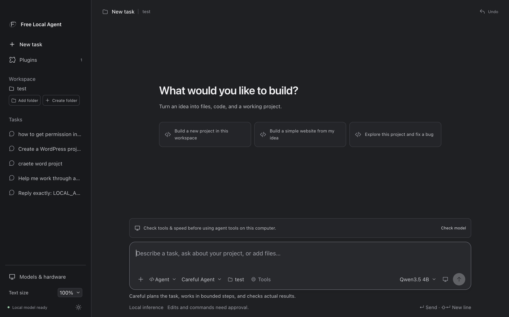

*Actual R7 regular profile on 2026-10-13, showing the five retained tasks,
selected workspace and Qwen model. The separate tool-calibration banner remains
visible; this startup capture does not establish a fresh Agent task.*

*Actual R7 fresh profile with no model. Choose model opens setup; returning to
the composer retained the draft and attachment while Send stayed disabled.
This verifies empty-model setup behavior, without an import or inference run.*

*Actual final R7 app, ASAR `f01867ce…90b7`. Gemma loading stopped at the sampled
memory budget: app last resident/limit 6.86 GiB, last available 7.62 GiB. Independent
samples confirmed the CPU-only process and its exit. Mapping/lazy sizes and the
absolute peak were unknown; Chat/tools never ran. The UI labels binary values GB;
the report uses GiB. This is a safety-stop result, not successful model execution.*

Earlier task and workspace captures

*Historical R6 ASAR `56a291ad…dfd3`: app resident sample 5.31 GiB against a
4.75 GiB budget, warning pressure; Chat/tools not reached. This earlier trial
retains its separate measurements and provenance in the validation report.*

*Actual final R4 app, ASAR `0968fd66…101e`, in its isolated validation profile.
The separate Qwen file task retained four ordered tool activities and completed
an approved creation/edit/readback sequence. The unquoted creation text lost a
period; this is narrower operation evidence, not full semantic task acceptance.*

*Actual final R4 answer/outcome view, exported through the app's File menu.
**Recorded checks passed** describes four operation checks; the UI asks the user
to review request fulfillment. See the [validation report](docs/alpha4-validation.md)
for the failed built-in model validation and remaining acceptance checks.*

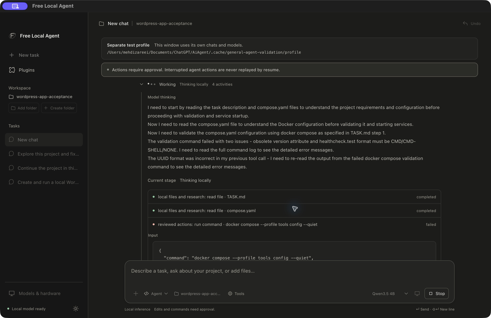

*Actual preceding R10 app during a guided task. **Working** shows model-supplied
thinking, completed file reads, and an approved configuration command with its
failure status. Tool inputs/results are expandable, and Working stays open
through updates. The generated healthcheck needs repair; this capture does not
show an installed WordPress site.*

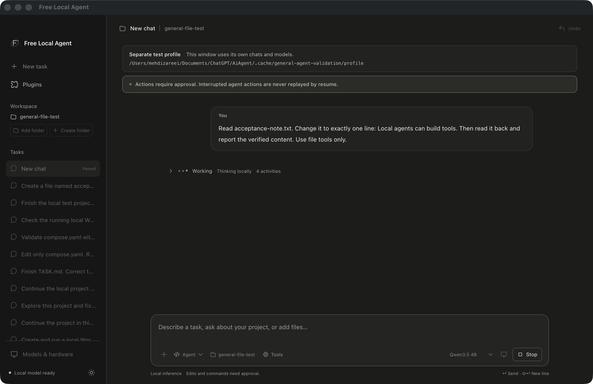

*Actual R12 packaged app in the isolated validation profile. The general file
task is running locally in `general-file-test`; the app shows the live Working
state and activity count while the model reads and edits the file.*

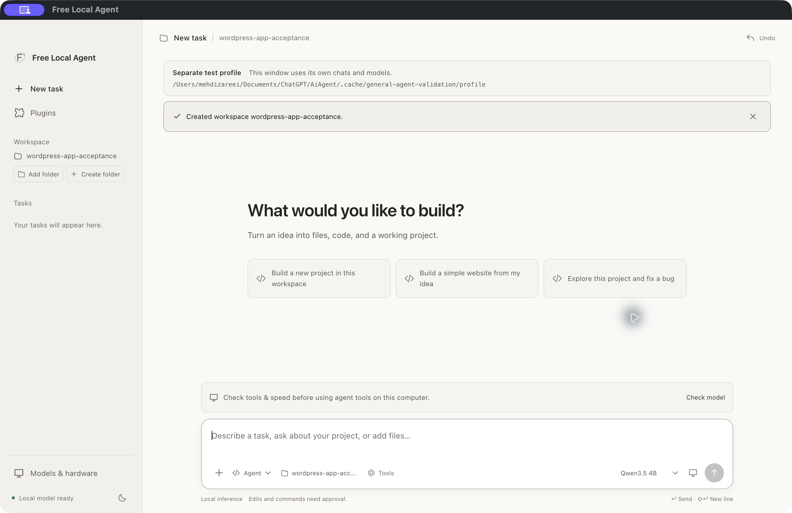

*Actual R7 packaged app after **Create folder** completed through its native
parent picker. `wordpress-app-acceptance` is selected in the separate validation
profile. Qwen3.5 4B is ready for calibration; no task is running in this capture.*

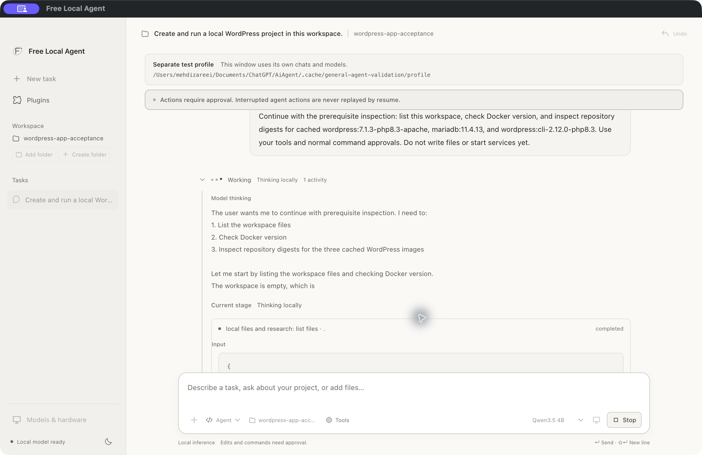

*Actual Qwen3.5 4B task in the R7 app. **Working** is expanded while model
thinking streams and a named tool activity is shown. Mouse, Space, and Enter
activation were visibly checked; the disclosure stayed expanded across tool
updates. This prerequisite stage does not establish an installed WordPress site.*

Earlier alpha.3 workspace and folder-dialog captures

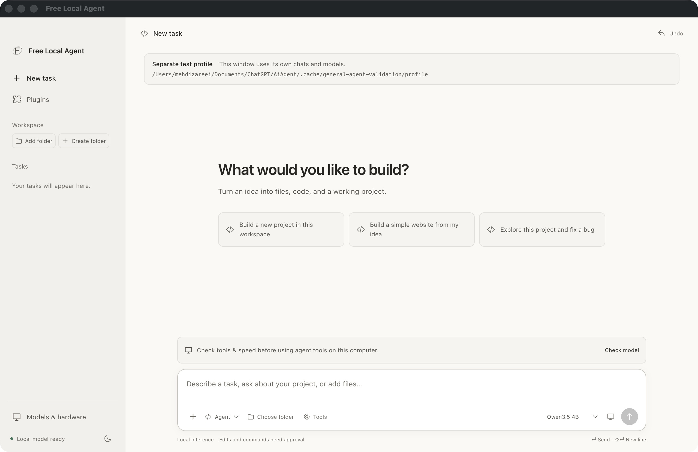

*Actual alpha.3 packaged workspace in a separate test profile, captured before
the command-log and folder-picker repairs. Its renderer assets stayed unchanged
through R7; R8 subsequently added durable tool history. Qwen3.5 4B
is selected and the local engine is ready; this window still requests tool
calibration and has no workspace folder selected. The capture shows the current
interface, not a completed task or expanded Working.*

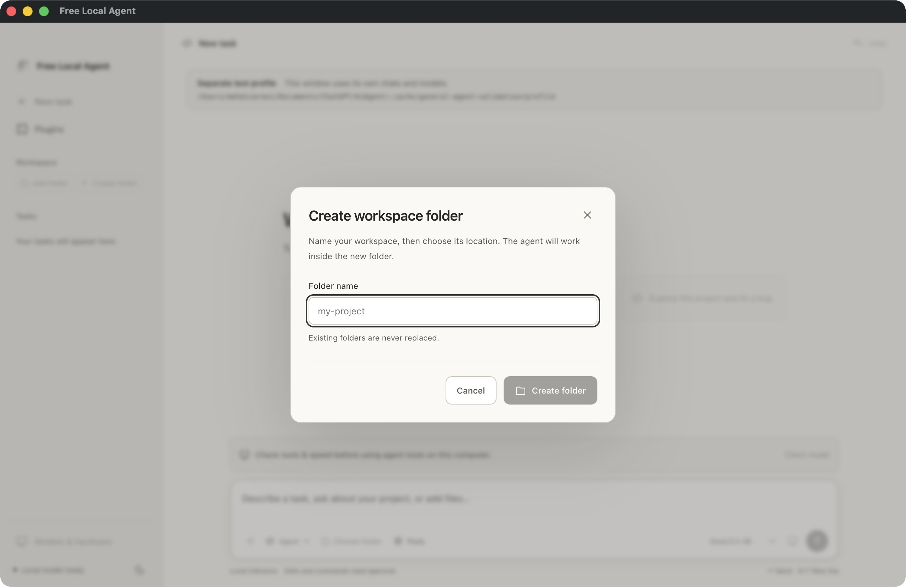

*Actual alpha.3 folder dialog before entering a name. It opens a native parent
picker afterward. This capture verifies the displayed controls; completing
native folder creation was not established by this earlier capture.*

Earlier alpha.2 workspace capture

*Actual 0.4.0-alpha.2 packaged macOS workspace, captured from a separate initial
profile before selecting a model. Research starts off. This is a native screenshot,
not a mocked conversation.*

## Models and hardware

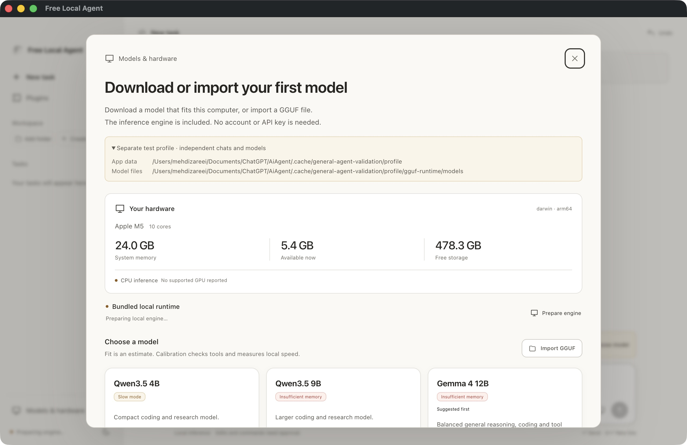

*Actual alpha.3 native onboarding from a separate test profile on an Apple M5
with 24 GB RAM. The engine was still preparing when this frame was captured;
available memory and provisional hardware/model-fit values are snapshots. This
is an empty-model setup screen, not a completed inference or task check.*

| Model | Quantization | Approximate download | Estimated working memory |
| --- | --- | --- | --- |
| Qwen3.5 4B | Q4_K_M | 2.7 GB | 4.5 GiB |
| Qwen3.5 9B | Q4_K_M | 5.7 GB | 8 GiB |
| Gemma 4 12B | QAT Q4_0 | 7.0 GB | 10 GiB |
| Gemma 4 26B A4B | QAT Q4_0 | 14.4 GB | 19 GiB |
| Gemma 4 31B | QAT Q4_0 | 17.7 GB | 23 GiB |

Catalog artifacts have pinned revisions, checksums, and license metadata.
Downloads support cancellation and resume, and the app verifies their SHA-256
before use. Four-bit quantization reduces storage and memory with a precision
tradeoff. These working-memory values are planning estimates, not measured peaks;
the app also reserves room for the operating system and considers available
memory and accelerator placement.

Model cards classify fit as **Recommended**, **Slow mode**, or **Insufficient
memory**. **Automatic** uses supported CPU/GPU profiles; **Allow slow mode**
permits slower profiles when the weights fit. **Low memory** starts with a 4K
context and smaller batches, and permits supported slow profiles.
Staged processing reduces the context needed for large documents and long chats;
in these modes, the model weights must still fit usable memory. A smaller active
parameter count in an expert model does not eliminate its stored weights.

**Experimental disk** is an opt-in, macOS ARM64-only CPU trial using mapped
weights, a 4K context, and smaller batches. Choose the mode, then **Try Experimental disk mode**;
selection alone never starts a trial. The app verifies the model and runs a load
and Chat probe before permitting inference; Agent also requires a native tool
probe. A failed tool probe leaves a successfully Chat-probed model Chat-only.
**Cancel trial** unloads the trial
model. Changing memory mode invalidates the trial. Original memory-fit labels
remain estimates, including **Insufficient memory**.

Trial metrics distinguish engine-reported mapped/lazy-eligible sizes from sampled
resident memory, available memory, and pressure; unmeasured values say **Unknown**.
The monitor can stop the owned inference process after a sampled resident-budget
or critical-pressure failure. This is sampled protection, not an operating-system
memory cap. Disk paging can be very slow, and unsupported tensor layouts may have
no lazy-eligible weights. It does not guarantee that a huge model can run on a
small computer or that a free local model matches frontier-model quality.

Imported models start with chat capabilities. Agent tools require a supported
architecture/template and passing native tool calibration. A chat-only model can
still process attached files through the app's local reading stages.

**Validate model for tasks** checks ordinary chat and native tool format, then
opens a small scratch Agent task with normal approvals for creation, exact edit,
and readback. Its recorded checks also require exact final bytes and a nonempty
final answer. Validation is specific to the model digest, runtime, and execution
profile; a passed load probe or speed measurement does not establish task quality.
The final R4 Qwen3.5 4B built-in validation failed on two exact-edit argument
mismatches; its blocked answer and unchanged file are preserved in the
[model-specific report](docs/alpha4-validation.md). Passing a separate simpler
task does not reclassify that result. Gemma's integrity passed, but its R7
loading safety stop left Chat/tool/task checks unverified. Broader task quality
remains unverified.

## Your tools, your approval

| Utility | Access and behavior |
| --- | --- |
| File and PDF reading | Reads files you attach or grant; works in every mode. Text PDFs only. |
| Find files & text | Searches filenames and text in the selected workspace in Agent mode. Read-only searches need no per-action approval. |
| File editing | Proposes workspace changes in Agent mode. Each edit, write, or new-file batch needs approval; saved file snapshots support undo. Creation batches cannot replace existing files. |
| Terminal commands | Shows the proposed command in Agent mode and asks for approval each time. Commands run as your operating-system account. |
| Web research | Available in Agent and Read-only research only with **Enable Research** and **Allow web research** turned on and a validated tool-capable model. Searches and public-page fetching use the internet. Queries go to DuckDuckGo; fetched URLs go to the source sites. |

Disabling Research omits its skill instructions and web tools while leaving local
Agent utilities available. The two research preferences are saved separately;
disabling the plugin retains your web permission for a later explicit enable.
Existing version 1/2 settings with explicit web consent migrate with Research on.
A version 3 store missing its plugin preference defaults off. Plugins currently
contains this bundled Research plugin; arbitrary external plugin installation is
not supported.

Disabled web tools are excluded from tool registration. Approved shell commands
can still access the network and files beyond the project; they have your account's
permissions and are not OS-sandboxed. Undo restores file snapshots and cannot
reverse terminal-command side effects. Resume verifies read checkpoints against
source hashes and never automatically repeats an agent edit or command.

Alpha.4 keeps approval state authoritative in the local host. Settled, denied,
cancelled, and expired requests are reconciled when the workspace reconnects,
regains focus, or encounters a response error, and periodically while approval is
pending. A stale message cannot restore a settled request or dismiss a newer one.
Reconnecting only reads current state; it never approves or replays an action.
Denial stops subsequent edits and commands for that turn. Send a new request to
continue after inspecting the recorded result.

Saved task outcomes show **Passed**, **Failed**, and **Unverified** checks with
their recorded operation evidence. **Recorded checks passed** means those checks
passed; it does not prove that the whole request was fulfilled. Review the files,
command results, and any unverified requirements.

## Get started

For an available local macOS build, check its identity in the
[validation report](docs/alpha4-validation.md), then unzip
`release/alpha4-delivery/Free Local Agent-0.4.0-alpha.4-arm64-mac.zip`, move
`Free Local Agent.app` to Applications, and open it. Apple Silicon and macOS 13.3 or newer are
required. This alpha is unsigned and not notarized.

1. Open **Models & hardware** and review your detected hardware.
2. Download a model that fits, or **Import GGUF** from a local file.
3. Select the model; optionally **Measure speed & tool format** or **Validate
   model for tasks**. Experimental disk requires its separate explicit trial.
4. Start **New task**, keep **Agent** selected, choose Standard or Careful,
   and choose a workspace before
   starting: use sidebar **Add folder**, or **Create folder** followed by its
   parent-folder picker. Describe what to build. Use **Chat** for conversation
   and attachments; enable Research in **Plugins** for its read-only mode.
5. Review each proposed edit or command before approving it.

See the [setup and developer guide](docs/setup-guide.md) for detailed setup,
source builds, packaging, storage locations, and permission boundaries.

Expand **Working** during a task to inspect its progress. Afterward, model
thinking can be expanded again and restored when you reopen the conversation.
Only model-supplied text is shown; the app does not invent reasoning. Thinking
storage is bounded to 64 KiB per reply. Named tool calls and their supplied
inputs/results are also saved with the assistant exchange and restored when a
task is reopened. The display retains up to 256 calls and 16 KiB each for input
and output, with visible truncation notices. Processing-stage progress remains
transient; saved activity never causes an action to run again.

To save a real PNG of the app for feedback or documentation, choose
**File → Save screenshot…** and select a location in the native Save dialog.

For a task that depends on changing software:

> Check this project's versions and the current official setup requirements.
> Explain relevant changes with source links, implement a compatible solution,
> and run available checks. Do not upgrade unrelated dependencies.

Enable **Plugins → Enable Research → Allow web research** first to verify online
facts. The plugin can also work with local sources when web permission is off;
it identifies changing facts it could not verify. Research is bounded and
uses primary sources rather than treating search snippets as documentation.
Fetch timestamps record when the app retrieved a page; page-supplied publication,
modification, and canonical metadata remain unverified claims. The skill does
not update model weights or install application updates. See the
[bundled task-research skill](local-agent/desktop/skills/task-research/SKILL.md).

For example, in an empty Agent workspace:

> Build a small website for my project. Inspect the available tools, create the
> files, run it locally, and verify the result. Report any concrete blockers.

Approve the proposed file batch and any setup commands after reviewing them.
Creating a scaffold produces project files; running a project also requires its
runtime and dependencies. Those must already be installed or installed through
approved commands, which may need the internet. See the
[WordPress verification example](docs/setup-guide.md#creating-a-wordpress-project).
WordPress is one example task; the agent has general file, command, and research
tools rather than a dedicated WordPress workflow.

## How local is it?

Free Local Agent bundles **llama.cpp v0.6.0** and a source-built **Goose v1.53.0** backend
with online model metadata, telemetry, and update features disabled. The app owns
the inference process and connects through an authenticated loopback endpoint.
Inference stays on the selected local model; there is no cloud-provider fallback.
End users do not need Python or Rust installed.

Model downloads and source dependency preparation need the internet. A local
GGUF import does not. Enabled web research, external links, and approved network
commands can use the internet. Chats, imported models, checkpoints, command logs,
and edit snapshots are stored locally. The legacy `Local Agent` data-folder name
is retained to preserve existing installations. The app adds no disk encryption.

## Validation and current limits

Alpha.4's approval reconciliation, task outcomes, Careful workflow, memory modes,
and model-validation controls are implemented. R9 passed **328/328 automated
checks**, TypeScript and actual packaged smoke under macOS-enforced public-network
denial. A fresh native task read a granted attachment outside the selected
workspace and completed its exact text/digest answer with one read-only tool.
R8 passed **327/327 automated
checks**, TypeScript and actual packaged smoke under macOS-enforced public-network
denial. Native empty setup, local model import, Chat/reopen, folder creation and
screenshot focus recovery passed. Working controls passed during a read task
that used the wrong relative path and was cancelled. A separate request in the
correct workspace passed one read and completed its exact text/digest answer.
R7 passed **315/315 automated
checks**, TypeScript, offline packaged smoke, 94 Python source tests and 8 frozen
protocol tests. Final R7 CLI repair, exact-file work, retained-file readback and
ordinary Chat passed their recorded checks; Chat/preferences survived reopening.
R7 empty/regular-profile startup checks also passed visibly. Reader/gateway/context fixes, model failures,
narrower file success, captures, and artifact hashes are separated in the
[alpha.4 validation report](docs/alpha4-validation.md). Gemma's R7 loading stop has
app-owned readings and independent owned-process samples/exit observation;
mapped/lazy sizes and absolute peak remain unknown, and inference/task quality
was not measured. The following results describe
earlier alpha.3 packages, not alpha.4 acceptance.

A **guided sequence of real native alpha.3 Agent tasks with Qwen3.5 4B** created,
repaired, started, and installed a local WordPress project. Independent
validation passed **12/12 checks**: valid configuration, healthy database,
installed WordPress **7.1.3**, intended site title, homepage HTTP **200**, and the
actual administration login form HTTP **200** on `127.0.0.1:8096`. PHP was
**8.3.35**, MariaDB **11.4.13**, and WP-CLI **2.12.0**. Official ARM64 image
digests and the read-only verification scope are in the
[native acceptance record](docs/wordpress-native-acceptance.json).

WordPress is one general-agent acceptance example. The tested 4B model needed
multiple bounded requests and corrections; this is not a one-prompt autonomy
benchmark. The app requested normal approvals for edits and commands. The
independent verifier inspected the result without setting up, starting, pulling,
installing, or editing it.

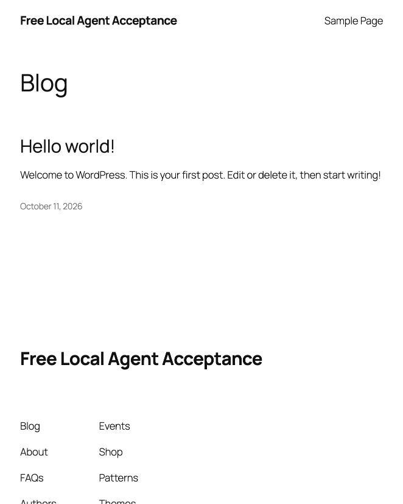

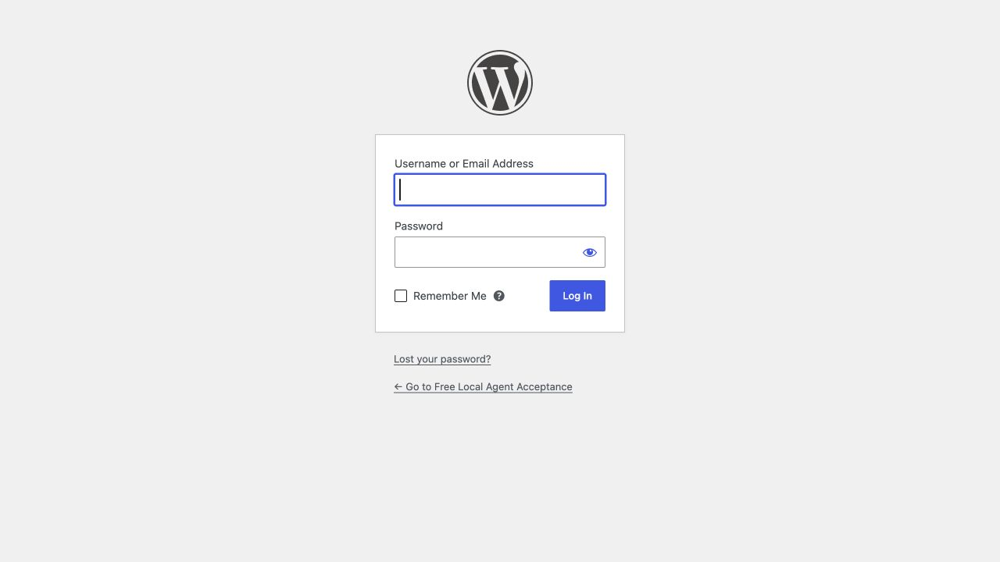

The install emitted an upload-directory permission warning. A later R12 app
task created the dated uploads directory as the web-server user, verified
the cached image digests, and created `RUNNING.md`
with stop/restart instructions. Independent read-only checks confirmed both
uploads directories writable as the web-server user. Browser media upload was
not tested. Ordinary Chat and final control checks were not established for
that historical R12 payload; R7 Chat/reopen passed above. Its general
file check applied the exact approved correction
and independent readback found `Local agents can build tools.`; the final
assistant readback state was not captured after the native approval surface
stopped refreshing. Final R7 closed that retained-file task with a fresh read-only
answer. See the [historical alpha.3 record](docs/general-agent-validation.md)
and [current alpha.4 evidence](docs/alpha4-validation.md).

The final R12 app also created and selected a new empty workspace through its
native folder picker. Earlier actual tests verified mouse/Enter/Space Working
activation on R7; current R12 mouse expansion persisted across updates, and its
seven saved tool records reopened visibly with model thinking. The screenshots carry their exact package provenance. Earlier offline
component Chat/file checks and incomplete attempts retain their original hashes
in the [component](docs/general-agent-components.json) and
[task-attempt](docs/general-agent-task-attempts.json) records.

The final alpha.3 source passed **210/210 app/runtime tests**, strict TypeScript,
and offline packaged smoke. Those historical checks retain their own scope;
the current R9 full-suite OS-enforced offline result is recorded above. The
recorded alpha.3 Apple Silicon ZIP is **216,988,256 bytes** in
`release/general-agent-delivery/`; exact archive, app, and backend checksums are
in the [delivery record](docs/general-agent-package.json). The earlier **14
synthetic renderer scenarios** have not been rerun on the current renderer.
Regular chats, six existing undo records, model size, and the separate preview's
interrupted download remained unchanged in read-only preservation checks.
Changes and installer artifacts remain local; nothing has been pushed or
published as a GitHub release.

This alpha supports text, code, and text PDFs. OCR/scanned PDFs, vision, audio,
CUDA-specific acceleration, browser/desktop automation, signed installers, and
automatic updates are deferred. Windows/Linux native runs, broader model
benchmarks, peak-memory/long-context measurements, and the
[task-quality rubric](docs/alpha-validation.md) remain pending. Short calibration
samples are not sustained task-performance benchmarks. The
[build verification](docs/build-verification.md) and
[compatibility report](docs/compatibility-report.md) retain historical results
and their practical limits.

## Source and licenses

The source is available on [GitHub](https://github.com/mahdizareeii/AiAgent).
Build instructions are in the [developer guide](docs/setup-guide.md). The desktop
uses Electron/React, the agent backend uses Goose, and the research utilities run
in a bundled native sidecar. See [architecture and boundaries](docs/architecture.md)
for the runtime, tool, and storage design.

Application code is [Apache-2.0](LICENSE). Bundled dependencies retain their own
licenses, including llama.cpp's MIT license; see [NOTICE](NOTICE). Model weights
are separate artifacts governed by their published licenses. The current catalog
records Apache-2.0 for each pinned model artifact.
