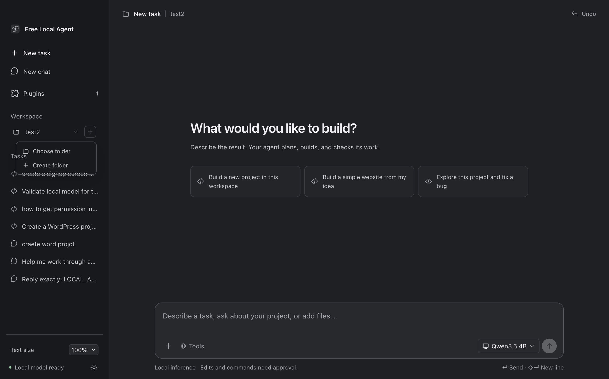
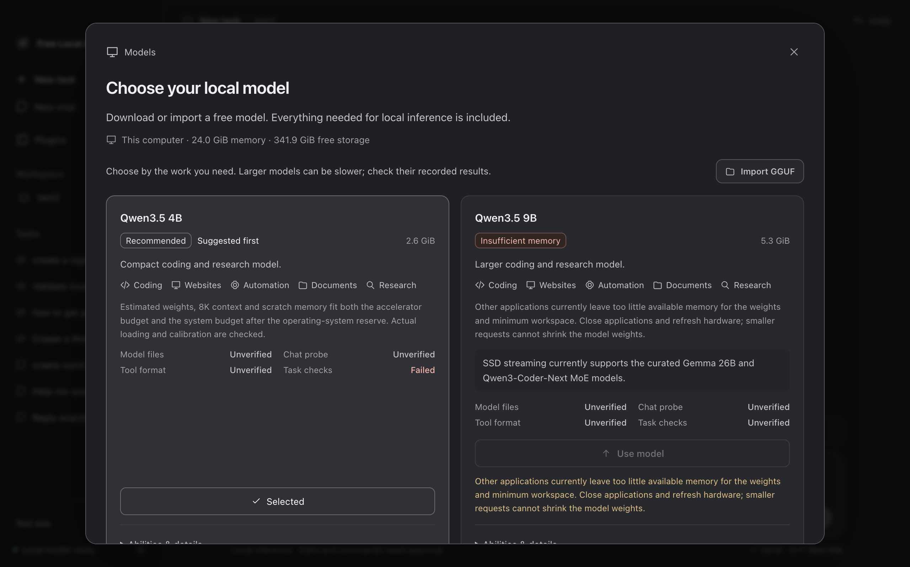
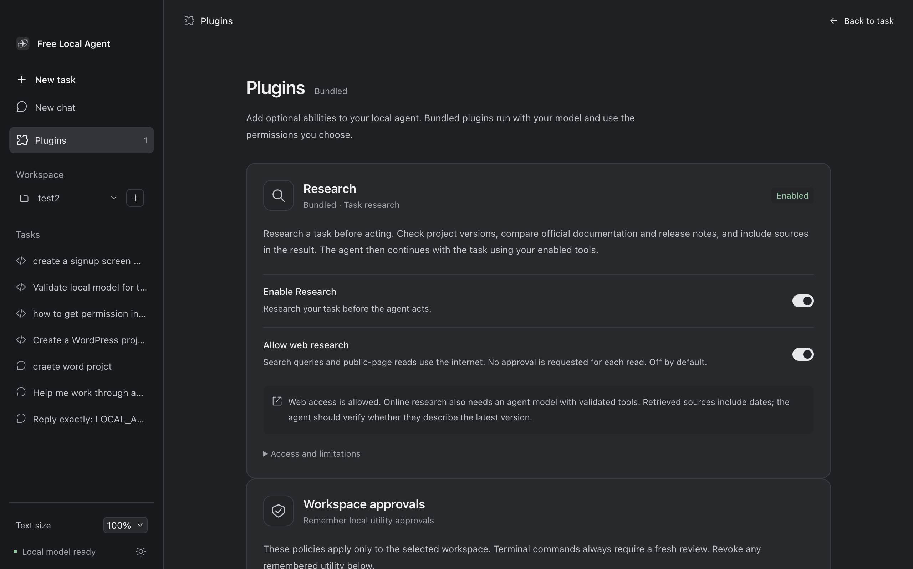

# Free Local Agent

**Your AI. Your machine. Your freedom.**

Free Local Agent is an open-source desktop assistant that runs free models on
your own computer. Ask it to build software, edit a project, explain code, read
text/PDF documents, or help with a task. It uses local file and terminal tools,
checks their results, and asks before changing files or running commands.

The app includes its inference engine and agent backend. No hosted-model account,
API key, subscription, Ollama, or separately installed model server is required.
Download model weights once, or import a local GGUF. Local Chat and project work
then operate offline. Internet research is an optional plugin and starts off.

**Version: 0.5.0-alpha.1.** This release simplifies task controls and introduces
experimental SSD expert streaming on Apple Silicon. The current model-specific
results, genuine capture status, failures, and package identity are kept in the
[alpha.5 validation report](docs/alpha5-validation.md). The preceding release's
results remain in the [alpha.4 report](docs/alpha4-validation.md); they are not
new alpha.5 test results.

Download the current platform package from the
[GitHub Releases](https://github.com/mahdizareeii/AiAgent/releases) page. Each
tagged release includes platform-specific installers and an aggregate
`SHA256SUMS` file. The current alpha's validation report records the exact
package identity and retained limitations.

Read the practical introduction and comparison at the
[project site](https://mahdizareeii.github.io/AiAgent/).

These are genuine captures of the packaged application in an isolated test
profile. The app verified four CLI input cases through one reviewed command and
reported the unchanged source digest in the [completed CLI task capture](docs/screenshots/alpha5/cli-verified-final-r9.png).
The original implementation and its earlier interrupted turn remain in the report.
The final UI captures below come from the packaged r17 build; the older R13/R14 captures remain as historical task evidence.

## One place to work

- **New task** plans, implements, verifies, and repairs observed failures. Choose
  or create a workspace through its single folder control, then describe the work.
- Coding tasks first run a bounded project preflight that detects the stack,
  selects local or bundled skills progressively, and records the evidence shown
  in Working. Web research remains opt-in; remote skills are never installed.
- **New chat** is a separate action for conversation and attached-document reading.
  Chat cannot edit a project or run commands.
- **Models** beside the composer opens the model library. Cards explain intended
  tasks, software examples, download size, compatibility, and local evidence.
- **Working** expands to show real model-supplied thinking when available, named
  tools, inputs, results, stages, and approvals. Mouse, Enter, and Space activate it.
  Expansion stays open during streaming, and reading suspends automatic scrolling.
- **Advanced** contains execution overrides, memory settings, hardware details,
  speed calibration, and model validation. Standard/Careful are internal execution
  approaches, rather than two agents competing for attention.
- Native fonts, neutral light/dark surfaces, 15 px conversation text, 14 px
  code/thinking, and 13 px controls keep the workspace readable. Text size persists
  from 90–125% without zooming the entire app.

Model cards use labelled icons for Coding, Websites, Automation, Documents, and
Research. Python, JavaScript, React, Node.js, and WordPress are examples of
workflows, not certifications. Execution also depends on installed prerequisites,
enabled utilities, and approvals. WordPress is a general task example, not a
special product feature or hardcoded agent shortcut.

The completed command's input, result, and Unicode output survived reopening.

Research stays off until you enable both the plugin and web permission. Completed public-source reads can be saved as bounded, cited notes under `.free-local-agent/research-notebook.json` in the selected workspace. Notes can be searched, exported, deleted, or cleared. This is retrieval memory; it never fine-tunes or changes model weights.

**Always approve** is offered for local file reading, project search, and file edits. Policies are normalized to the selected workspace and can be revoked in Plugins. Terminal commands remain manually approved for every command.

The plus button beside Workspace opens the native Choose folder and Create folder flows. Draft text and attachment selections are saved per chat while idle, then restored when you return to that chat.

Its disclosure was checked with mouse, Enter, and Space. Ordinary Chat also
retained its [visible answer of 42](docs/screenshots/alpha5/chat-42-reopened-r13.png),
with no project tools or approvals.

## Larger models from SSD

The experimental worker keeps attention, routers, shared experts, context state,
and temporary buffers resident. Routed experts live in the local GGUF files.
A bounded cache reads selected experts from SSD as needed, reusing cached experts
and evicting others. It preserves quantized values and computes every selected
expert; it does not prune experts or silently replace the model.

This differs from the previous mapped-file disk trial. Ordinary mmap/lazy loading
was not a bounded expert cache, and its historical trial results do not validate
the new worker. The normal pinned engine and Qwen fallback remain available.

| Model | Download | Route |
| --- | ---: | --- |
| Qwen3.5 4B Q4_K_M | 2.55 GiB | Normal local inference |
| Qwen3.5 9B Q4_K_M | 5.29 GiB | Normal local inference |
| Gemma 4 12B QAT Q4_0 | 6.50 GiB | Normal local inference |
| Gemma 4 26B A4B QAT Q4_0 | 13.45 GiB | Normal or experimental SSD expert streaming |
| Gemma 4 31B QAT Q4_0 | 16.44 GiB | Normal inference; dense-model SSD streaming unavailable |
| Qwen3-Coder-Next 80B Q4_K_M | 45.09 GiB, four shards | Experimental SSD expert streaming |

Artifacts use pinned publisher revisions and SHA-256 checksums. Split models are
usable only after every shard passes verification. Downloads are resumable,
cancellable, and bounded to four independent shard streams. Import all parts of
an exact supported split GGUF together. Download eligibility depends on storage;
low RAM does not prevent acquiring weights.

For a supported installed model, choose **Try from SSD** directly on its card.
The app unloads its previous model, measures current headroom, verifies the worker
and model set, and runs bounded Chat/tool probes. A failed or cancelled trial
preserves the previous selection and draft. Existing normal memory-fit labels
remain visible; experimental eligibility is a separate assessment.

The worker requires at least 24 expert slots per layer for Gemma and 30 for Qwen.
Its budget includes non-expert weights, cache, KV/recurrent state, graph scratch,
staging, uploads, and reserved overhead. Apple unified memory is counted once.
Native allocation guards and two-second footprint/RSS/pressure checks stop unsafe
execution. These are bounded allocation and sampled protections, not a guarantee
of total operating-system memory or universal huge-model compatibility.

New SSD tasks receive four active hours, with eight available under Advanced.
Approval waits pause the clock; approval expiry and reviewed command limits stay
unchanged. Forty model steps and three repair cycles prevent unlimited retries.
Cancellation or expiry preserves completed actions and requires an explicit new
request; the app never automatically replays commands or edits.

Qwen3-Coder-Next is a non-thinking model: Working shows its real tool activity
and progress without inventing thought text. Bigger parameter counts, slower
execution, and successful speed calibration do not establish higher task quality
or Astra/Claude-level correctness.

## Evidence you can inspect

Cards distinguish **Weights verified**, **Chat probe**, **Tool format**, and
**Task checks**. Evidence is bound to actual digests, chat template, engine,
profile, and time. Publisher descriptions are guidance, not local test results.
Failed and unverified outcomes remain visible.

**Validate model for tasks** runs a small exact-file workflow through normal
approvals. A passed file fixture establishes that fixture, not universal skill.
The release report also records independent CLI checks, measured memory,
waiting time, download interruptions, and native UI evidence. Models must pass
the relevant native checks before being labelled ready for tasks.

## Your utilities and approvals

| Utility | Access and approval |
| --- | --- |
| Read files and text PDFs | Selected workspace and explicitly attached files; bounded reads retain references. OCR and scanned PDFs are deferred. |
| Find files & text | Local selected-workspace search; no internet search. |
| Edit project files | A proposed exact change waits for approval; verified changes have local undo records. |
| Terminal | Shows the command, directory, and time limit before approval. Commands run with your permissions and may access the network. |
| Research plugin | Enable in Plugins; internet sources additionally require Allow web research. Both start off. |

Approved terminal commands can install or use tools such as Node, Docker, PHP,
or package managers when those prerequisites are available. The app does not
bundle every development platform or control arbitrary desktop applications.
Denied actions stay denied. Single-use approvals, authoritative settlement,
revisioned snapshots, exact UTF-8 editing, and action receipts protect against
stale panels, repeated edits, and automatic replay.

## Get started

1. Open the Apple Silicon application from the local delivery package listed in
   the [validation report](docs/alpha5-validation.md).
2. Choose a model, download it, or use Import GGUF. An empty library shows setup
   instead of a generic engine error; your draft and attachments are retained.
3. Use a model that fits, or explicitly Try from SSD for a supported MoE model.
4. Start New task, choose/create a workspace, and enable the needed utilities.
   Use New chat for ordinary questions.
5. Review each proposed edit/command and Approve once or Deny. Expand Working to
   inspect actual activity. Stop cancels current work.

Existing profiles keep chats, attachments, projects, downloads, models, and undo
history. Separate test profiles display their own storage path. Migrated tasks
retain their prior execution approach and one-hour budget. New tasks use the
simplified workflow. Research remains off on a fresh installation.

## Build and licenses

See the [setup/developer guide](docs/setup-guide.md) and
[architecture](docs/architecture.md). Application source is
[Apache-2.0](LICENSE); bundled dependencies retain their own licenses, including
llama.cpp's MIT license. Models are separate publisher artifacts. See [NOTICE](NOTICE).

The normal engine remains pinned llama.cpp v0.6.0/build 11429. The experimental
worker is a separate audited backport of an
[unmerged SSD-streaming proposal](https://github.com/ggml-org/llama.cpp/pull/25294),
with additional allocation, cache-floor, cancellation, upload, and macOS I/O
protections. It is not an upstream stable-release feature.

Initial SSD support is Apple Silicon. Windows/Linux keep normal CPU/Vulkan
inference and await native SSD validation. Text, code, and text PDFs are the
initial formats; OCR, vision, audio, CUDA-specific acceleration, signed installers,
and automatic app updates are deferred. Tagged builds publish unsigned,
unnotarized installers through the GitHub Releases workflow; model weights remain
separate publisher downloads.
