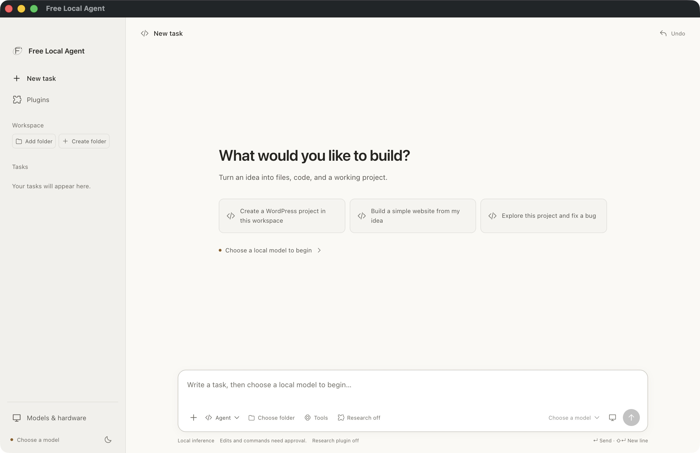
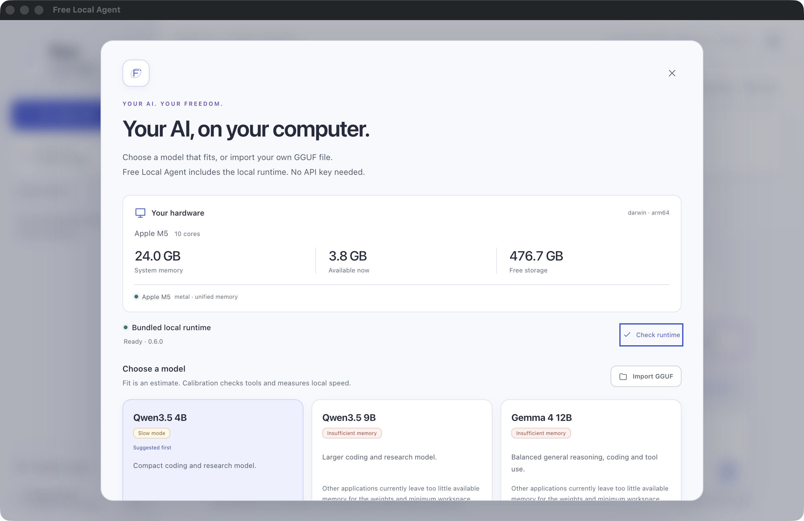

# Free Local Agent

**Your AI. Your machine. Your freedom.**

Free Local Agent is an open-source desktop AI agent for chat, coding, research,
and documents. It runs a free model on your own computer, using a bundled
inference engine. You choose the model, the project, and the tools it can use.
File edits and terminal commands wait for your approval.

No hosted model account, API key, subscription, Ollama, or separately installed
model server is required. Model weights are a separate download or local GGUF
import. Once a compatible model is installed, chat and local file work can run
offline.

**Current version: 0.4.0-alpha.2.** macOS Apple Silicon is the tested platform.
Windows and Linux packaging/CI is configured; native validation is still pending.

## What Free Local Agent does

- **Build in Agent mode.** New tasks start in Agent mode. Choose or create a
  workspace, then ask the model to inspect files, build a project, fix code, or
  run checks using the enabled tools. It reports what its tools actually did.
- **Chat locally.** Agent, Read-only research, and Chat modes use the same locally
  stored conversations. Responses come from the model running on your machine;
  tool-capable models stream replies, while chat-only imports return completed replies.
- **Work with a project.** Search selected project files, propose edits, run
  approved terminal commands, and restore file snapshots with per-chat undo.
  New files can be proposed as one reviewed batch of 1–20 files, with up to
  512 KiB of total text and grouped undo. PHP and PHTML files can be read and searched.
- **Choose a workspace folder.** **Add folder** in the sidebar opens an existing
  folder. **Create folder** asks for a name, then opens a native picker for its
  parent folder. Creation never overwrites an existing file or folder; canceling
  the picker creates nothing. Start **New task** to change a saved task's workspace.
- **Expand the work in progress.** Click **Working**, or focus it and press Enter
  or Space, to see the current stage, tool activity, and thinking text supplied
  by the local model. Thinking stays separate from the answer and is saved
  locally with the reply, including partial text from a stopped or failed turn.
  A model that does not emit thinking text is identified as such.
- **Read larger documents gradually.** Text, code, Markdown, and text-based PDFs
  are read in bounded stages and summarized with source references. Progress,
  cancellation, and local read checkpoints help manage longer tasks.
- **Choose a model for this computer.** Hardware detection and model cards explain
  memory fit, quantization, download size, licenses, and tool compatibility.
  Optional calibration checks tool calling and measures generation speed.
- **Control the utilities.** **Tools** controls file reading, project search,
  editing, and terminal commands. These local Agent tools work independently of
  the optional research plugin.
- **Add research when needed.** Open **Plugins → Enable Research** for a bundled
  workflow that checks project versions and changing requirements. Separately
  enable **Allow web research** to consult official documentation, release notes,
  and migration guidance. Both settings default off on new installations. The
  agent cites fetched sources, then continues the task using your enabled tools.
- **Use a focused task workspace.** A neutral, Codex-inspired interface places
  saved tasks in a sidebar, the conversation in the center, and the composer at
  the bottom. Mode, workspace, model, and tool controls sit beside your message.
  The light/dark theme preference is remembered locally.

| Mode | Use it for |
| --- | --- |
| Agent | Creating or changing a project, then running approved checks in a selected workspace. Research is an optional plugin; Agent requires a validated tool-capable model. |
| Read-only research | Reading sources and comparing findings. The mode choice appears when Research is enabled; existing saved research tasks remain readable with the plugin off. Web tools require both plugin activation and web permission. |
| Chat | Conversation, writing, and attached-file reading. Project changes and commands require an Agent task. |

## Workspace

*Actual 0.4.0-alpha.2 packaged macOS workspace, captured from a separate initial
profile before selecting a model. Research starts off. This is a native screenshot,
not a mocked conversation.*

## Models and hardware

*Actual 0.3 Models & setup screen from an isolated validation profile on an Apple M5
with 24 GB RAM. The 3.8 GB
available-memory reading was a snapshot while a separate model validation run
was active; it is not the computer's total RAM or a fixed model requirement.*

| Model | Quantization | Approximate download | Estimated working memory |
| --- | --- | --- | --- |
| Qwen3.5 4B | Q4_K_M | 2.7 GB | 4.5 GiB |
| Qwen3.5 9B | Q4_K_M | 5.7 GB | 8 GiB |
| Gemma 4 12B | QAT Q4_0 | 7.0 GB | 10 GiB |
| Gemma 4 26B A4B | QAT Q4_0 | 14.4 GB | 19 GiB |
| Gemma 4 31B | QAT Q4_0 | 17.7 GB | 23 GiB |

Catalog artifacts have pinned revisions, checksums, and license metadata.
Downloads support cancellation and resume, and the app verifies their SHA-256
before use. Four-bit quantization reduces storage and memory with a precision
tradeoff. These working-memory values are planning estimates, not measured peaks;
the app also reserves room for the operating system and considers available
memory and accelerator placement.

Model cards classify fit as **Recommended**, **Slow mode**, or **Insufficient
memory**. Slow mode can use CPU or partial GPU offload and a smaller context.
Staged processing reduces the context needed for large documents and long chats;
the model weights must still fit usable memory. A smaller active parameter count
in an expert model does not eliminate its stored weights.

Imported models start with chat capabilities. Agent tools require a supported
architecture/template and passing native tool calibration. A chat-only model can
still process attached files through the app's local reading stages.

## Your tools, your approval

| Utility | Access and behavior |
| --- | --- |
| File and PDF reading | Reads files you attach or grant; works in every mode. Text PDFs only. |
| Project search | Searches the selected workspace in Agent mode. Read-only searches need no per-action approval. |
| File editing | Proposes workspace changes in Agent mode. Each edit, write, or new-file batch needs approval; saved file snapshots support undo. Creation batches cannot replace existing files. |
| Terminal commands | Shows the proposed command in Agent mode and asks for approval each time. Commands run as your operating-system account. |
| Web research | Available in Agent and Read-only research only with **Enable Research** and **Allow web research** turned on and a validated tool-capable model. Searches and public-page fetching use the internet. Queries go to DuckDuckGo; fetched URLs go to the source sites. |

Disabling Research omits its skill instructions and web tools while leaving local
Agent utilities available. The two research preferences are saved separately;
disabling the plugin retains your web permission for a later explicit enable.
Existing version 1/2 settings with explicit web consent migrate with Research on.
A version 3 store missing its plugin preference defaults off. Plugins currently
contains this bundled Research plugin; arbitrary external plugin installation is
not supported.

Disabled web tools are excluded from tool registration. Approved shell commands
can still access the network and files beyond the project; they have your account's
permissions and are not OS-sandboxed. Undo restores file snapshots and cannot
reverse terminal-command side effects. Resume verifies read checkpoints against
source hashes and never automatically repeats an agent edit or command.

## Get started

For a packaged macOS build, unzip `Free Local Agent-0.4.0-alpha.2-arm64-mac.zip`, move
`Free Local Agent.app` to Applications, and open it. Apple Silicon and macOS 13.3 or newer are
required. This alpha is unsigned and not notarized.

1. Open **Models & hardware** and review your detected hardware.
2. Download a model that fits, or **Import GGUF** from a local file.
3. Select the model; optionally run **Check tools & speed**.
4. Start **New task**, keep **Agent** selected, and choose a workspace before
   starting: use sidebar **Add folder**, or **Create folder** followed by its
   parent-folder picker. Describe what to build. Use **Chat** for conversation
   and attachments; enable Research in **Plugins** for its read-only mode.
5. Review each proposed edit or command before approving it.

See the [setup and developer guide](docs/setup-guide.md) for detailed setup,
source builds, packaging, storage locations, and permission boundaries.

Expand **Working** during a task to inspect its progress. Afterward, model
thinking can be expanded again and restored when you reopen the conversation.
Only model-supplied text is shown; the app does not invent reasoning. Thinking
storage is bounded to 64 KiB per reply. Current tool/stage activity is not saved
as conversation history and is not restored on reopening a task.

For a task that depends on changing software:

> Check this project's versions and the current official setup requirements.
> Explain relevant changes with source links, implement a compatible solution,
> and run available checks. Do not upgrade unrelated dependencies.

Enable **Plugins → Enable Research → Allow web research** first to verify online
facts. The plugin can also work with local sources when web permission is off;
it identifies changing facts it could not verify. Research is bounded and
uses primary sources rather than treating search snippets as documentation.
Fetch timestamps record when the app retrieved a page; page-supplied publication,
modification, and canonical metadata remain unverified claims. The skill does
not update model weights or install application updates. See the
[bundled task-research skill](local-agent/desktop/skills/task-research/SKILL.md).

For example, in an empty Agent workspace:

> Create a local WordPress project here. Inspect the available tools, create the
> setup and a small custom theme, then run the checks you can. Tell me what still
> needs installing before the site can start.

Approve the proposed file batch and any setup commands after reviewing them.
Creating a scaffold produces project files; running WordPress also requires its
runtime and dependencies. Those must already be installed or installed through
approved commands, which may need the internet. See the
[WordPress walkthrough](docs/setup-guide.md#creating-a-wordpress-project).

## How local is it?

Free Local Agent bundles **llama.cpp v0.6.0** and a source-built **Goose v1.53.0** backend
with online model metadata, telemetry, and update features disabled. The app owns
the inference process and connects through an authenticated loopback endpoint.
Inference stays on the selected local model; there is no cloud-provider fallback.
End users do not need Python or Rust installed.

Model downloads and source dependency preparation need the internet. A local
GGUF import does not. Enabled web research, external links, and approved network
commands can use the internet. Chats, imported models, checkpoints, command logs,
and edit snapshots are stored locally. The legacy `Local Agent` data-folder name
is retained to preserve existing installations. The app adds no disk encryption.

## Validation and current limits

The [0.4.0-alpha.2 Working and folder validation record](docs/working-folders-validation.md)
tracks expandable model thinking and native workspace creation. The current
package and update are local artifacts; this update has not been pushed or
published as a GitHub release. The previous
[0.4.0-alpha.1 workspace and plugin validation record](docs/workspace-plugin-validation.md)
tracks the redesigned interface and independent research controls. The model
setup image above is historical 0.3 evidence, not a capture of the new workspace.

Earlier checks on a **24 GB Apple M5** with Qwen3.5 4B passed real local chat, native tool calling,
token counting, and a Goose/MCP file-read smoke with public networking blocked.
Separate short native and earlier Local Agent packaged-app calibrations measured
**30.8–37.5 tokens/sec**. These measurements are not a broad model-quality or peak-memory
benchmark. See the [measured compatibility report](docs/compatibility-report.md).

The 0.3-alpha.2 research update passed **115 app/runtime tests**, **75 research
tests**, and the macOS packaged smoke. One real Qwen4B task fetched official
WordPress requirements, created an approved research note, and read it back with
matching evidence. Strict note quality failed its length constraint and
overstated one server recommendation. See the
[research validation record](docs/task-research-validation.md).

The earlier 0.3-alpha.1 automated and packaged checks passed. A real Qwen4B Agent task created
five approved files, but its full WordPress scaffold failed validation. A separate
two-file theme task passed one approved batch, real file readbacks, and static
checks. No PHP or WordPress runtime was executed and no site was started.
Separate short native calibrations measured **24.97** and **38.61 tokens/sec**;
these are not complete-task or production-theme benchmarks. The initial model
setup screenshot is partial GUI evidence; further GUI checks and captures remain
pending because the macOS capture tool failed. The
[update validation record](docs/agent-update-validation.md) tracks current tests,
the real-model project-creation check, and packaged screenshots. The
[verification report](docs/build-verification.md) separates current automated
checks from historical 0.2 results, including the distinction between
network-denied native tests and normal GUI checks.

This alpha supports text, code, and text-based PDFs. OCR/scanned PDFs, vision,
audio, CUDA-specific acceleration, browser/desktop automation, signed installers,
and automatic updates are deferred. Windows/Linux native runs, broader catalog
benchmarks, long-context peak memory, and the
[task-quality rubric](docs/alpha-validation.md) remain pending. Summaries can omit
details, and model answers or tool proposals can be wrong.
Tool access and an action-oriented workflow do not establish Codex-equivalent
model quality; larger coding tasks still need review and validation.

## Source and licenses

The source is available on [GitHub](https://github.com/mahdizareeii/AiAgent).
Build instructions are in the [developer guide](docs/setup-guide.md). The desktop
uses Electron/React, the agent backend uses Goose, and the research utilities run
in a bundled native sidecar. See [architecture and boundaries](docs/architecture.md)
for the runtime, tool, and storage design.

Application code is [Apache-2.0](LICENSE). Bundled dependencies retain their own
licenses, including llama.cpp's MIT license; see [NOTICE](NOTICE). Model weights
are separate artifacts governed by their published licenses. The current catalog
records Apache-2.0 for each pinned model artifact.
