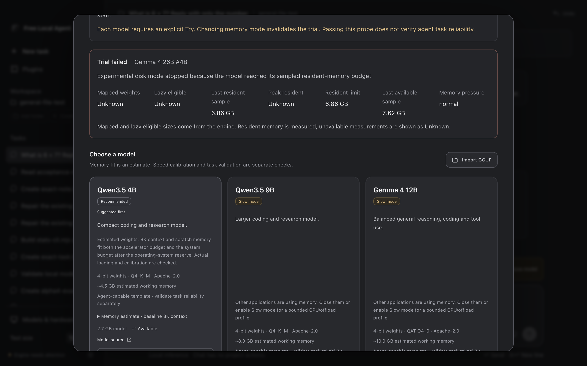
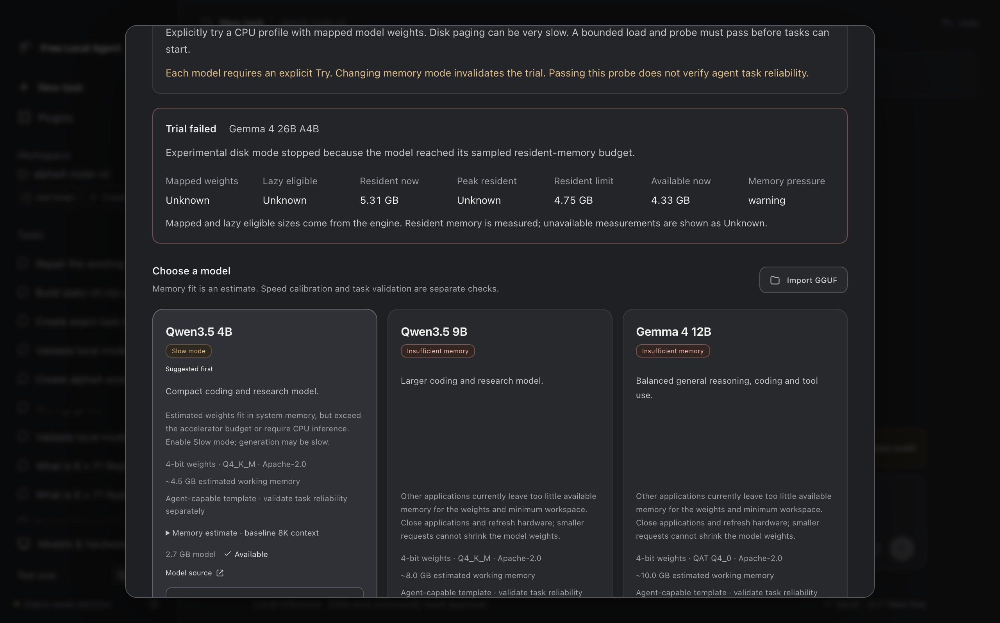
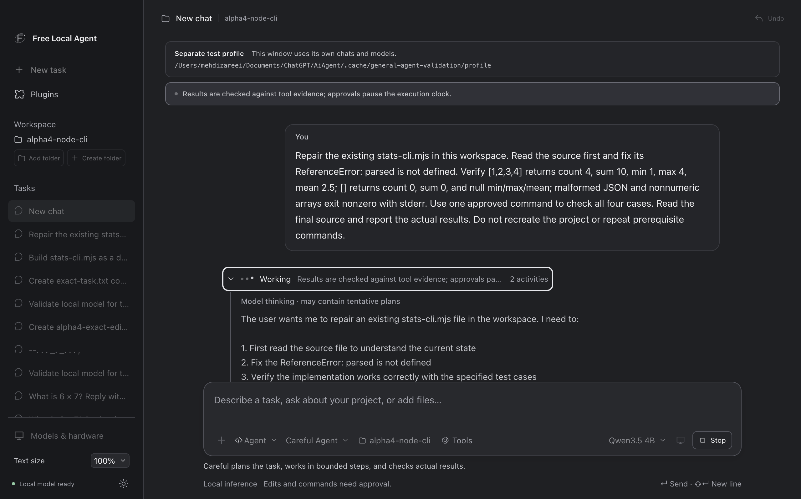
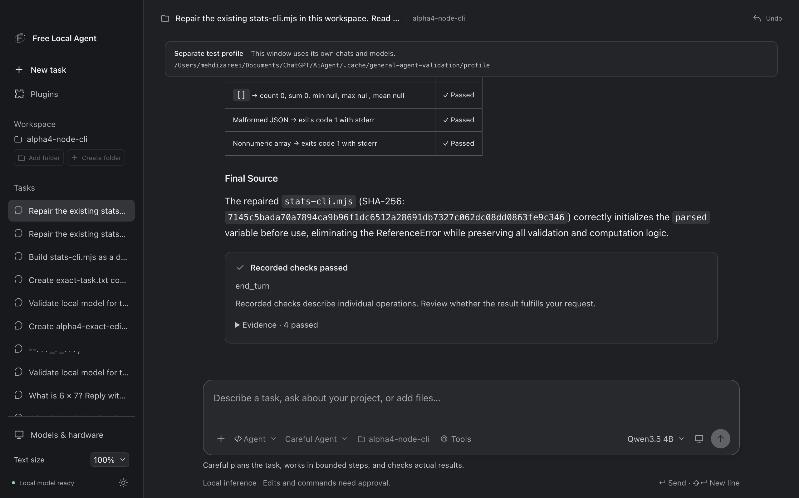
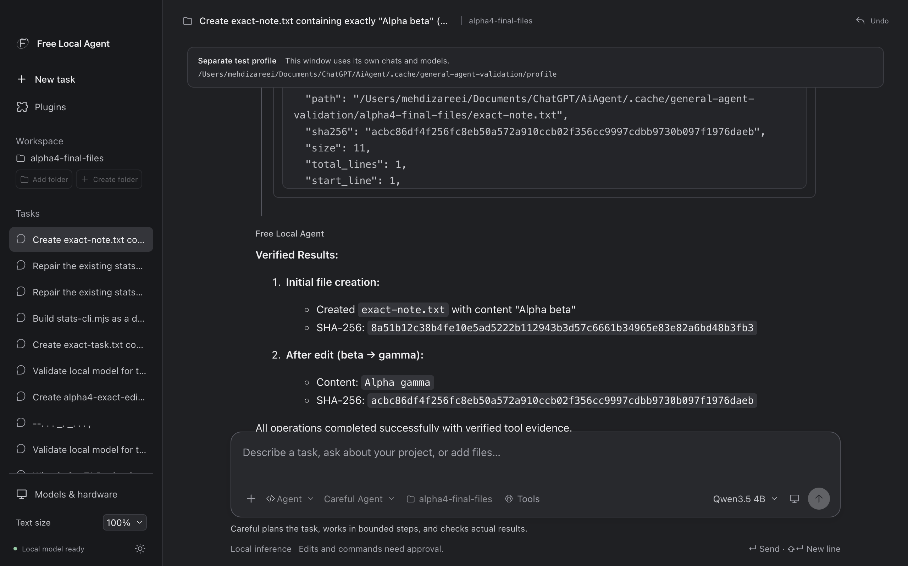
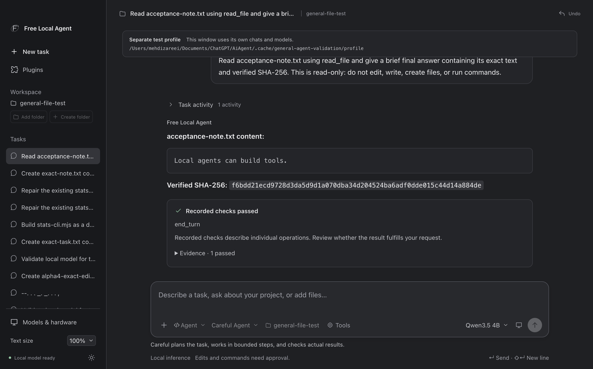
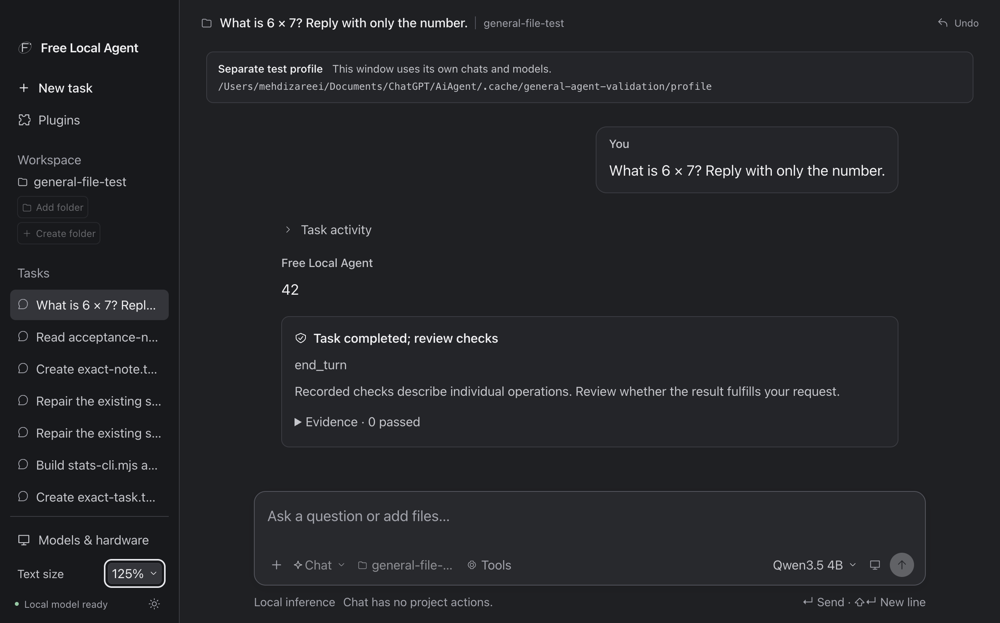
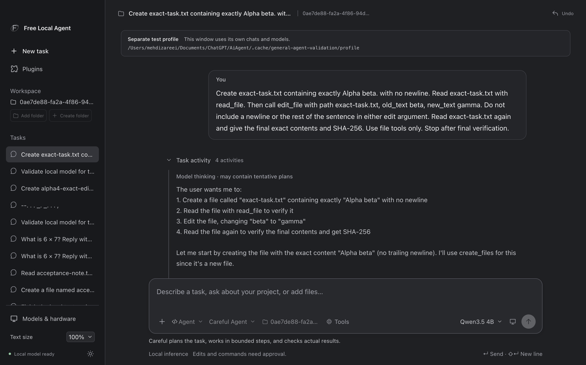
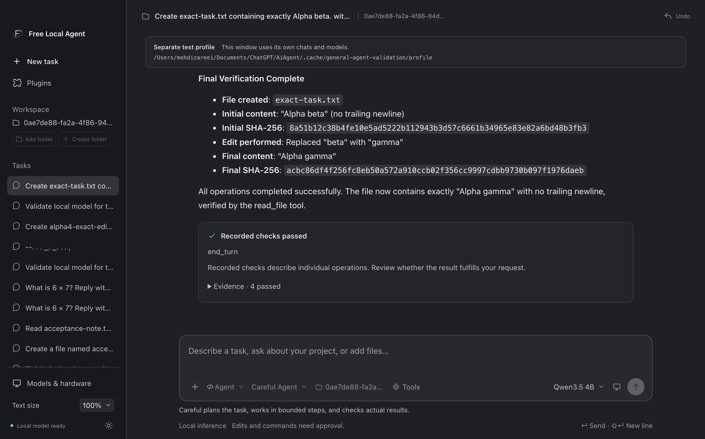

# Alpha.4 validation — draft evidence record

Date: **2026-10-12**. Version: **0.4.0-alpha.4**. **R7 packaging, 315 offline
automated tests, TypeScript, packaged smoke, 94 Python source tests and 8 frozen
protocol tests passed. R7 CLI repair, exact-file work, retained-file readback and
ordinary Chat passed their recorded checks; Chat/preferences survived reopening.
Empty-profile UI and regular-profile visible checks remain unverified while the
Mac is locked; the regular app process has been reopened.** Native
Qwen calibration measured 28.9 tokens/sec on Metal with 8K context, and Working
mouse/Enter/Space expansion was visibly checked during a running CLI repair.
That app-applied repair passed **4/4 independent input checks**, with its final
answer/readback and completed terminal state visibly confirmed.
The verified Gemma download reached an explicit final R7 experimental load,
which the app stopped at its sampled resident-memory budget before Chat/tool
probes. Independent resource samples confirmed the owned CPU-only process and
its exit; returning to Automatic restored Qwen Metal inference. Delivery
remains local. This draft preserves payload identities, failures and genuine
captures separately; it does not establish general model competence or complete
project autonomy.

The implementation and screenshots were committed **locally** as `ea8cd31`;
no push was performed. Later documentation corrections retain the unchanged
R7 ZIP/ASAR identity below.

## Final R7 package identity

| Artifact | Size | SHA-256 |
| --- | --- | --- |
| `release/alpha4-delivery/Free Local Agent-0.4.0-alpha.4-arm64-mac.zip` | 217,114,537 bytes | `de0560f026408548543ada24a425cc3640113c5793a7c45a52217c8f96b23d8f` |
| `release/alpha4-delivery/mac-arm64/Free Local Agent.app/Contents/Resources/app.asar` | 32,012,010 bytes | `f01867ceffcb0363cec3a632aa99a33a4ddbbb33762961026a6a5a6fc65890b7` |

Both sizes and full-file hashes were independently read from the final R7
delivery. The read-only native observer's
`.cache/general-agent-validation/native-alpha4r7-evidence.json` reports the same
ASAR identity and `observerPerformedActions=false`. Its persisted-state evidence
does not substitute for visible native task acceptance.

## Regular profile process and read-only preservation

The final delivery app is reopened through its exact executable **without a
user-data override**. The read-only audit found one unique regular main process,
and helper flags consistently identify
`~/Library/Application Support/Local Agent` as its actual profile. Its ASAR hash
matches final R7 `f01867ce…90b7`. This establishes the reopened process/profile
identity; the locked Mac still prevents visible confirmation of that window.

Compared with the captured baseline, the retained regular `chats.json` is
**byte-identical**, with **5 chats**, their captured messages/attachments/project
paths/settings unchanged, and **6 unchanged undo records**. The full retained
Qwen GGUF is **2,740,937,888 bytes** and independently matches its catalog SHA-256
`00fe7986ff5f6b463e62455821146049db6f9313603938a70800d1fb69ef11a4`.
The persisted store remains **version 3**; no save-triggered version-4 rewrite
has occurred. Live in-memory migration/defaults were not queried or visibly
verified, so missing v4 preference fields are not treated as zero values.

The separate preview's persisted chats/settings are also byte-identical to their
baseline. Its partial Qwen download remains **156,942,952 bytes**, with current
full-file SHA-256
`6f23f0e409cfcf089b25c473645a41f909d56f47aae28f5a11c1b2237e39e424`.
The baseline did not contain that partial file's hash, so this establishes its
retained size and current identity, not a before/after hash comparison. **The
preview's unsent draft is unverified:** the baseline contains no draft text,
and no live preview process/UI was observed. Persisted-store preservation must
not be described as proof that a transient draft was retained.

Provenance is retained in
`.cache/general-agent-validation/alpha4-r7-independent-preservation-before-regular.json`
and `alpha4r7-final-regular-profile-audit.json`. These were read-only audits;
they performed no app interaction, profile edits or process signals.

<details>
<summary>Retained R4–R6 package identities</summary>

## Recorded R6 package identity

| Artifact | Size | SHA-256 |
| --- | --- | --- |
| Retained R6 ZIP: `.cache/general-agent-validation/alpha4-r6-artifacts/Free Local Agent-0.4.0-alpha.4-arm64-mac.zip` | 217,114,683 bytes | `7f177ea0aff4ccade7203cacd9070124b94fda84883716ef85a80d55e06d3430` |
| Retained R6 validation app: `.cache/general-agent-validation/alpha4-r6-artifacts/Free Local Agent Alpha4 Final Validation.app/Contents/Resources/app.asar` | 32,011,703 bytes | `56a291ada80b3abd71cbbf897fe79c5bb6c40e596f9cdccee140ce36b7c2dfd3` |

These archived sizes and full-file hashes were independently read after the R6
Gemma trial. They identify that recorded payload; they do not identify a later
replacement at the delivery path.

## Recorded R5 package identity

| Artifact | Size | SHA-256 |
| --- | --- | --- |
| Retained R5 ZIP: `.cache/general-agent-validation/alpha4-r5-artifacts/Free Local Agent-0.4.0-alpha.4-arm64-mac.zip` | 217,111,765 bytes | `894d94a50e98ab76a3d0544d4b8aa5c14e2353ac64c5dde154bc708be54a78d6` |
| Retained R5 validation app: `.cache/general-agent-validation/alpha4-r5-artifacts/Free Local Agent Alpha4 Final Validation.app/Contents/Resources/app.asar` | 31,999,443 bytes | `ca368e3731b4632afc43a05dde23b9b46d475a6010528cf45cfbaba2dfa1d41b` |

These sizes and full-file hashes were independently read from the R5 delivery
before replacement. R5 native observations were captured in
`.cache/general-agent-validation/native-alpha4r5-evidence.json`, which reports
the same R5 ASAR and `observerPerformedActions=false`. A capture can include saved
historical chats; only a fresh, payload-bound run establishes new native evidence.

## Recorded R4 package identity

| Artifact | Size | SHA-256 |
| --- | --- | --- |
| Retained R4 ZIP: `.cache/general-agent-validation/alpha4-r4-artifacts/Free Local Agent-0.4.0-alpha.4-arm64-mac.zip` | 217,109,378 bytes | `114a3703fc1d27da483a2f9d0015aa2c6552cd306c3a6b4e36230cb6004e1161` |
| Retained R4 validation app: `.cache/general-agent-validation/alpha4-r4-artifacts/Free Local Agent Alpha4 Final Validation.app/Contents/Resources/app.asar` | 31,988,030 bytes | `0968fd66ebe22d8fbfe347d1c22c8e1581f0a5c879cb5f7649abe9ca2ccd101e` |

Both values were read from the R4 delivery files before the R5 rebuild. These
historical hashes do not identify a future replacement at the same delivery path.
The R4 ZIP was retained as a read-only copy at the path above with the same hash.
The archived native R4 app uses an isolated validation identity/profile and
retains the same R4 ASAR hash. It is not the regular user's app/profile. The macOS package is
unsigned and not notarized. No GitHub release or push is implied by this record.

</details>

The app bundles llama.cpp **0.6.0**, pinned build **11429**, and the offline
source-built Goose **1.53.0** backend. Model weights are separate local downloads
or imports; the app uses its owned loopback inference endpoint with no cloud
fallback or Ollama service dependency.

## Automated checks and their scope

| Check | Result | Scope |
| --- | --- | --- |
| Final R7 app/runtime suite and types | **315/315 passed**, zero failures, skips, or cancellations; TypeScript passed | Rerun under macOS-enforced public outbound-network denial, localhost allowed. Recorded suite duration **20.5651 seconds**. Includes Metal-device retention across experimental RAM refresh. Not 315 real-model tasks. |
| Final R7 packaged offline smoke | **Passed**, exit 0, darwin-arm64 | Also run with macOS public outbound networking denied. Packaged denial/unchanged-file check, runtime pins/hashes/native version, offline Goose manifest, actual ACP tool startup, and default-off web registration. No model loaded/downloaded or public network tool called. |
| R7 Python source suite | **94/94 passed**, exit 0 | **5.19 seconds**; local temporary fixtures and mocked networking. Includes exact module-source reading and existing file/PDF/security checks. |
| R7 frozen-sidecar protocol suite | **8/8 passed**, exit 0 | **4.58 seconds**; tests the already-built native sidecar, including `.mjs/.cjs/.mts/.cts` exact text, BOM/CRLF/Unicode/hash, grants, paging and optional web registration. No GUI or real-model execution. |
| R6 app/runtime suite and types | **314/314 passed**, zero failures, skips, or cancellations; TypeScript passed | Recorded suite duration **20.8806 seconds**. Includes local loopback tests, host-bound deterministic action compaction and policy-deduplication regressions. No OS-enforced public-network-denial claim is made for this archival full-suite run. Not 314 real-model tasks. |
| R6 packaged offline smoke | **Passed**, exit 0, darwin-arm64 | Packaged denial/unchanged-file check, runtime pins/hashes/native version, offline Goose manifest, actual ACP tool startup, and default-off web registration. No model loaded/downloaded or public network tool called. |
| Final R5 app/runtime suite and types | **301/301 passed**, zero failures, skips, or cancellations; TypeScript passed | Recorded suite duration **20.6659 seconds**. Includes local loopback tests and regressions for authoritative host context failures, preserved action context, and recovered allocations. No OS-enforced public-network-denial claim is made for this archival full-suite run. Not 301 real-model tasks. |
| Final R5 packaged offline smoke | **Passed**, exit 0, darwin-arm64 | Packaged denial/unchanged-file check, runtime pins/hashes/native version, offline Goose manifest and actual ACP tool startup. No model loaded/downloaded or public network tool called. |
| R4 app/runtime suite | **291/291 passed**, zero failures, skips, or cancellations | Contract, boundary, recovery, keyboard, markup, runtime and local loopback tests. No OS-enforced public-network-denial claim is made for this archival full-suite run. Deterministic providers/engines are used where appropriate; this is not 291 real-model tasks. |
| R4 packaged offline smoke | **Passed** on darwin-arm64 | Packaged Electron/ASAR bridge denies a write and leaves the project unchanged; runtime pins/hashes/native version and offline Goose manifest verified; actual packaged Goose ACP initializes both local tool servers. |
| Frozen research/mode registration in smoke | **Passed** | File tools registered; web absent by default and available only after explicit enablement in Agent/Research, remaining absent in Chat. No model loaded/downloaded and no public network tool called. |

Local logs:

- `.cache/general-agent-validation/alpha4-full-offline-r7-enforced.log`
- `.cache/general-agent-validation/alpha4r7-package.log`
- `.cache/general-agent-validation/alpha4r7-packaged-smoke.log`
- `.cache/general-agent-validation/alpha4-r7-python-validation.json`
- `.cache/general-agent-validation/alpha4-full-offline-r6.log`
- `.cache/general-agent-validation/alpha4-package-final-r6.log`
- `.cache/general-agent-validation/alpha4r6-packaged-smoke.log`
- `.cache/general-agent-validation/alpha4-full-offline-r5.log`
- `.cache/general-agent-validation/alpha4-package-final-r5.log`
- `.cache/general-agent-validation/alpha4r5-packaged-smoke.log`
- `.cache/general-agent-validation/alpha4-full-offline-r4.log`
- `.cache/general-agent-validation/alpha4-package-final-r4.log`
- `.cache/general-agent-validation/alpha4r4-packaged-smoke.log`

Automated success verifies the tested implementation contracts. It does not
establish native interaction with every control, sustained speed, huge-model
memory fit, or the quality of a model's generated project.

The final R7 full-suite offline result uses `sandbox-exec` with the retained
`offline.sb` policy: outbound networking is denied except localhost. The earlier
R7 run's 20.8325-second result was not wrapped by that OS policy and is not used
as the final offline evidence. The enforced rerun changed no source or app
payload; final ZIP/ASAR identities above remain unchanged.

**Scope separation:** the real-model native Qwen tasks/Chat, Gemma trials and
visible interactions ran with normal system networking available. Their local
execution evidence does not establish a real-model native UI run under enforced
public-network denial. That denial was enforced for the final contract suite
and packaged smoke; the smoke loaded no model. The attempted denied-network
native launcher below failed before UI and leaves that acceptance unverified.

## Qwen3.5 4B — R7 Node CLI repair independently passed

Session `8c7f5065-fb63-4109-9539-39705d0a8763` used the general Careful Agent in
the existing `alpha4-node-cli` workspace. It inspected and read the existing
`stats-cli.mjs`, repaired the `parsed` scope error through **one normal approved
edit**, ran **one normal approved four-case verification command**, and read the
final source. No observer repaired the artifact. The app's approved repair
action is `cc77134b-7c84-498c-9ead-f42a95f7fcff`; the verification command is
`93638657-be56-4b85-91bc-a2d073ca2580` and returned exit **0**.

The repaired source is **1,214 bytes**, SHA-256:

```text
7145c5bada70a7894ca9b96f1dc6512a28691db7327c062dc08dd0863fe9c346
```

An independent Node **v26.7.0** check ran at **15:32:06 UTC** without modifying
the source. Its before/after hashes matched the approved edit receipt and all
**four required cases passed**:

| Input | Verified result |
| --- | --- |
| `[1,2,3,4]` | Exit 0; count 4, sum 10, min 1, max 4, mean 2.5. |
| `[]` | Exit 0; count 0, sum 0; min, max and mean null. |
| Malformed `[1,2` | Exit 1 with `Error: Invalid JSON format`, no stdout. |
| Nonnumeric `[1,"two",3]` | Exit 1 with `Error: All items must be finite numbers`, no stdout. |

Evidence is retained in
`.cache/general-agent-validation/stats-cli-r7-validation.json`, bound to final
R7 ASAR `f01867ce…90b7`. The saved session finalized at **15:34:28.491 UTC** with
`completed` / `end_turn`, a **1,255-byte** nonempty final answer, the approved
edit/command checks, and final readback. **Visible terminal completion was
confirmed**: New task became available and the final answer/readback/outcome
was visible. Genuine File-menu captures show the live expanded Working and final
CLI result; hashes are recorded below.
This separate repair does not reclassify the failed R4/R5 attempts or the failed
built-in model validation. It verifies this CLI artifact and these four cases,
not general task correctness. The fixture is absent from production prompts/tools.

## Qwen3.5 4B — R7 exact file, retained readback and ordinary Chat

The fresh exact-file session `585dd9c3-3aad-4e28-bf51-f0381a601468` created
`exact-note.txt` containing precisely `Alpha beta` without a newline, read it,
used a real `edit_file` replacement `beta` → `gamma`, and read the final file.
Two normal approvals covered creation and edit; no commands ran. The requested
**create → read → exact edit → read** sequence passed. Independent byte reading
confirmed **11 bytes**, exactly **`Alpha gamma`**, no newline, SHA-256:

```text
acbc86df4f256fc8eb50a572a910ccb02f356cc9997cdbb9730b097f1976daeb
```

The model first probed the absent file with `read_file`, which returned
`FILE_NOT_FOUND`. That initial failure remains recorded alongside the four
passed sequence checks: **five tool calls, four passed checks and one failed
pre-creation probe**. The saved outcome is `completed` / `end_turn` at
**15:40:11.329 UTC**, with a **403-byte** nonempty final answer containing the
verified content/hash. The model's blanket success sentence does not erase the
earlier failed probe. Unlike the historical R4 task, this request specified the
exact text boundary, and the requested final bytes were established.

Read-only session `226b63da-2eb5-482d-965e-7832226bbaa5` then read the retained
`acceptance-note.txt` once, with **no new creation, edit, command or approval**.
Its final answer visibly contains **`Local agents can build tools.`** and SHA-256
`f6bdd21ecd9728d3da5d9d1a070dba34d204524ba6adf0dde015c44d14a884de`.
Independent reading confirmed **29 bytes** with no newline. It completed with
`end_turn` at **15:42:36.629 UTC**, a **160-byte** final answer and one passed
readback check. This closes the retained-file acceptance through a fresh request;
it does not replay or reclassify the earlier failed edit turn.

Ordinary Chat session `c541fac4-c66b-444c-a9fb-4989984d7693` asked
“What is 6 × 7? Reply with only the number.” It visibly answered exactly **`42`**
and saved `completed` / `end_turn` at **15:43:44.193 UTC**, with **zero tool
calls, checks or approvals**. The genuine capture uses **125% text scale**.
After a graceful app quit and relaunch of the same final R7 app/profile, the saved
Chat was selected and visibly showed **`42`**, **Chat** mode and the retained
**125%** text setting, with no approval panel. The quit exited **0**. The scale
was then restored to **100%** through the normal text-size control. This verifies
that Chat and preference persistence across reopening, without resending the
prompt or calling tools.

## Qwen3.5 4B — final R4 built-in task validation

Hardware: Apple M5, **24 GiB** unified memory, macOS ARM64. Model:
`qwen3.5:4b`, Q4_K_M. Model digest:
`00fe7986ff5f6b463e62455821146049db6f9313603938a70800d1fb69ef11a4`.
Chat-template hash:
`7f0e529032c25183bcd66c7f238da2d377f43be754a94e2725a58c4e16d2ed67`.

The recorded effective profile was **Automatic**, **Metal**, **8,192 context
tokens**, **2,048 output tokens**, **batch 256**, **microbatch 64**, and **one
slot**, bound to engine commit
`d81235049384534c167caea52b85a694f6103d14`. Allow slow mode was enabled in the
isolated profile. The task used Careful Agent with file tools and normal approval;
terminal and web research were disabled.

Validation record: `0ae7de88-fa2a-4f86-94d3-567db45e80cf`.
Session: `dfa2581e-3db0-4e95-a141-96865f40a6a6`.
Started **13:05:34.580 UTC**, completed **13:07:52.034 UTC**. Recorded elapsed
time: **137,454 ms**, including validation/preparation and approval overhead; this
is not a tokens-per-second benchmark.

**Overall model-validation result: Failed.** The app's saved outcome is **blocked**,
with a nonempty 465-byte closing answer identifying the exact-edit blocker.

| Recorded acceptance check | Result | Evidence |
| --- | --- | --- |
| Ordinary Chat | Passed | Exact response `42` to the short arithmetic probe. |
| Native tool format | Passed | Local native tool-call calibration succeeded. |
| Exact create/read/edit/read sequence | **Failed** | One approved creation and two successful reads; both requested edits failed, and expected final bytes were never produced. |
| Model/profile identity | Passed | Prepared digest, runtime and effective profile matched the task. |
| Successful final answer | **Failed** | The task was blocked, although a nonempty and explicit blocker answer was saved. This is not an empty-answer failure. |
| File-only validation | Passed | No terminal tool called. |

The created file was exactly **24 bytes**, with a real trailing LF (`0a`):

```text
Local validation first.
```

Its SHA-256 remains
`b4472f35c4307e5e6bbeebfa9d5349e3541ba0b3fedb9811114499bda9e86665`.
The model supplied a **25-byte** `old_text` ending in literal backslash-plus-`n`
(`5c6e`). That differs from the source newline. The first edit returned
`TEXT_NOT_FOUND`; the second identical edit against the unchanged file returned
`REPEATED_EDIT_FAILED`. Both reported `changed=false`. The turn stopped before
further mutation; completed creation and its undo record were preserved.

This is a model argument mismatch, not evidence that the app stripped or
normalized the source text. Successful creation/read receipts do not turn this
failed requested sequence into a task pass. A later successful separate request
must retain its own evidence and cannot reclassify this validation record.

The read-only observer reported `observerPerformedActions=false`. Evidence is
stored locally in `.cache/general-agent-validation/native-alpha4r4-evidence.json`
and the isolated profile. The independent byte audit read the existing file; it
did not repair it or execute project commands.

## Qwen3.5 4B — R4 Node CLI attempt failed

Session `567dd419-3b91-4a51-92be-119e58fc8fa6` requested a dependency-free
`stats-cli.mjs`, a source read, and approved tests for numeric, empty, malformed,
and nonnumeric JSON inputs. It ran in the app-created
`.cache/general-agent-validation/alpha4-node-cli` workspace with Careful Agent.
The saved model identity was the same Qwen digest, Automatic/Metal, 8K context.
The session finalized at **13:25:36.650 UTC**.

**Result: Failed, not a working CLI.** Normal approvals allowed `node --version`
(**v26.7.0**), source creation, `ls -la`, and the numeric-input test. The source was
**1,208 bytes**, SHA-256
`dff7ee645ad95250cd73db702ec9d2048d7beef3320e3a5d708094dd83faec98`.
Two `read_file` calls and one `inspect_file` call rejected `.mjs` as unsupported
in the R4 sidecar. A later `write_file` proposed the same bytes and returned
`changed=false`; it did not repair the program or create another mutation.

The approved command `node stats-cli.mjs "[1,2,3,4]"` exited **1**, with
`ReferenceError: parsed is not defined` at line 28. The generated code declared
`const parsed` inside a `try` block and then referenced it outside that scope.
The valid numeric case did not produce the expected JSON. Empty/malformed/
nonnumeric acceptance was not established. The read-only documentation audit
read the saved source/log; it did not run or repair the CLI.

**R4 outcome-classification defect:** later context processing returned HTTP
**400**, `Required context still does not fit after compaction`. Goose surfaced
that error as assistant text with `end_turn`; the saved host outcome incorrectly
said `completed`. That status is not a task pass. The assistant error and failed
numeric command remain recorded. This exposed an application classification
defect separately from the model's code error and the sidecar suffix gap.

## R5 Node repair attempt — blocked context preserved

R5 added `.mjs/.cjs/.mts/.cts` source reading and made host inference failures
authoritative for task outcomes. Native session
`c9e88161-87d2-4eee-b1c4-08b85fb90641` successfully read the existing module, but
its proposed edit returned `TEXT_NOT_FOUND`, `changed=false`. Subsequent context
processing failed; the saved outcome was correctly **blocked**, with a nonempty
**614-byte** answer at **14:41:40.607 UTC**. The source retained its R4 hash
`dff7ee64…ec98`; that attempt did not repair or rerun the program.

R6 then removed duplicated app instructions and added deterministic compaction
for closed actions bound to actual host receipts. Current requests and
latest/pending tools remain exact; saved raw records, denied/error states, file
hashes and command-log pointers remain available. Compaction never replays an
action. Automated regressions cover those boundaries; the R7 repair above is
separate real-model evidence.

Actual native runs used `.cache/general-agent-validation/profile`, an isolated
validation profile. A planned `profile-r5` clone was unused for app actions.
The validation app retained a bundle identity ending in `r4` while its payload
was replaced; archived R4/R5/R6 artifacts preserve each ASAR identity. App name,
bundle ID, copied chats and historical screenshots cannot establish a new
payload's acceptance. Neither profile is the regular user's store.

## Gemma 4 26B A4B — integrity passed, R7 loading stopped

The pinned **Gemma 4 26B A4B**, QAT Q4_0 download completed through the app,
including the earlier cancel/resume path. The artifact is **14,439,363,584 bytes**
(approximately **13.45 GiB** or **14.44 GB**), revision
`d1c082be9cf3c8a514acf63b8761f4b41935842e`. Independent full-file hashing completed
at **14:49:18.077 UTC** and matched the catalog pin:

```text
3eca3b8f6d7baf218a7dd6bba5fb59a56ee25fe2d567b6f5f589b4f697eca51d
```

Integrity provenance is retained locally in
`.cache/general-agent-validation/gemma26-integrity-alpha4.json`. That successful
download/hash is separate from runtime compatibility or model quality.

The **final R7** app ran a new explicit **Try Experimental disk mode** on the
**24 GiB Apple M5**. **Result: watchdog stopped loading before properties, Chat,
native tools, or Agent checks.** The actual UI reported:
“Experimental disk mode stopped because the model reached its sampled
resident-memory budget.” No model-quality result was produced.

The independent read-only observer verified that the engine belonged to the
approved validation app, matched the exact Gemma GGUF path, and used **CPU-only
(`--device none`, zero GPU layers), 4K context, batch 128, microbatch 32, F16 KV,
mmap, lazy mode on, fitting off, one slot and offline loopback inference**.
Engine agent tools, web UI, prompt/idle cache and context shift were disabled.
These observed flags establish the launched configuration, not lazy eligibility
for every weight or expert.

| Last app-owned measurement | Value |
| --- | --- |
| Last resident sample | **6.86 GiB**, rounded |
| Resident stop threshold | **6.86 GiB**, rounded |
| Last available sample | **7.62 GiB**, rounded |
| Memory pressure | **Normal** |
| Mapped bytes, lazy-eligible bytes, app peak resident value | **Unknown** |
| Chat, native tools, Agent checks, inference speed | **Not reached** |

App samples and independent samples are separate measurements. The external
observer recorded two owned-process RSS samples:

| UTC sample | Resident bytes | Available bytes | Pressure |
| --- | --- | --- | --- |
| **15:49:14.694** | **5,041,635,328** | **8,253,505,536** | Normal |
| **15:49:16.698** | **7,341,031,424** | **8,213,741,568** | Normal |

The maximum of these samples was **7,341,031,424 bytes** (about **6.84 GiB**),
and the owned process exit was observed at **15:49:18.696 UTC**. This is a sampled
maximum, **not an absolute peak or a hard cap**. The app's two-decimal display
does not reveal the exact threshold comparison. A sample can reach or exceed
the threshold before termination. Public networking, unrelated processes and
swap settings were not changed by the observer.

Provenance is retained in
`.cache/general-agent-validation/gemma26-r7-trial-validation.json` and
`gemma26-r7-resource-samples.json`, bound to final R7 ASAR `f01867ce…90b7`.
Neither resource observer rehashed the weights; the independent completed
integrity record above supplies that separate evidence. The trial retained the
verified weights. After changing to **Automatic**, the actual UI retained Metal,
selected Qwen3.5 4B, and returned to ready **Metal / 8,192 context** inference;
the displayed **28.9 tokens/sec** calibration was verified again.



*Genuine unchanged final R7 File-menu capture. Binary memory quantities are
labeled GB in the UI; this report expresses them in GiB. SHA-256:
`e579d61df939f32b19d6e4cf1bf035d862881acba9d0571d82d9182df85a349b`.*

This is a verified safety-stop outcome under that trial's available memory,
not a successful load or a claim that Gemma cannot run on every 24 GiB computer.
No Gemma Chat/tool/task pass, sustained speed, absolute peak, lazy-tensor coverage,
or frontier-model quality is claimed.

<details>
<summary>Earlier R6 trial: separate loading stop and app samples</summary>

The R6 packaged app then ran **Try Experimental disk mode** on the current
**24 GiB Apple M5**. The CPU-only trial used mapped weights, 4K context, batch
128, microbatch 32, and the app's sampled memory watchdog. **Result: loading
stopped before properties, Chat, or native tool probes.** The app reported:
“Experimental disk mode stopped because the model reached its sampled
resident-memory budget.”

| Last app-owned measurement | Value |
| --- | --- |
| Resident memory | **5.31 GiB** |
| Resident stop threshold | **4.75 GiB** |
| Available memory | **4.33 GiB** |
| Memory pressure | **Warning** |
| Mapped bytes, lazy-eligible bytes, peak resident memory | **Unknown** |
| Chat, native tools, task quality, inference speed | **Unverified; probes did not run** |

An earlier app sample showed 4.02 GiB resident and 4.16 GiB available. These are
the app-owned monitor readings observed in the real UI. They are not an
independent peak-memory benchmark. The external read-only observer started
after the short-lived model process window and did not observe that engine;
its independent peak and exit measurements remain unknown. Provenance and that
limitation are preserved in
`.cache/general-agent-validation/gemma26-r6-resource-samples.json`.



*Genuine R6 app capture, ASAR `56a291ad…dfd3`. The UI labels these binary memory
quantities as GB; the report expresses them in GiB. R7 retains that unit-label
limitation and clarifies the stopped values as last samples. The screenshot is
unchanged. Its SHA-256 is
`a76341f507f21f41b1e018f83d061686c475dd5be8943b56875d6997be214900`.*

The safety stop preserves the downloaded weights and permits a later explicit
trial. It does not establish that this model can run at the measured available
memory or on every 24 GiB computer. No Gemma task pass, sustained speed,
lazy-weight coverage, or huge-model usability is claimed.

</details>

## R7 runtime and native interaction checks

R7 retains the separately verified Metal/Vulkan accelerator descriptors when an
experimental trial refreshes RAM and disk measurements. Returning to Automatic
can therefore choose the detected accelerator instead of losing GPU discovery
during a CPU-only trial. The experimental launch itself remains CPU-only. Its UI
also labels retained measurements as **Last resident sample** and **Last available
sample**. Chat and tool-format readiness remain separate runtime conditions;
the trial heading itself still says **Load and probe passed**. Binary
quantities are still labeled GB in the UI. Source review found no new approval,
replay, receipt, or deadline regression; the suite/package checks above passed.
The successful separate Qwen repair does not reclassify the failed Gemma
trial or the historical Qwen failures.

R7's Qwen3.5 4B native calibration measured **28.9 tokens/sec** on **Metal** with
**8,192 context tokens**. The app returned to a working task screen after
calibration. During the live CLI-repair session
`8c7f5065-fb63-4109-9539-39705d0a8763`, mouse, Enter and Space visibly collapsed
and expanded Working with real thinking and tools retained. These checks establish
calibration and interaction behavior. The CLI's four independent checks and saved
completion, fresh-file/ordinary Chat and Chat-reopen results are recorded above.
Empty/regular-profile verification remains pending.

## Qwen3.5 4B — separate R4 file-operation sequence

Session `d48b2462-84b0-42eb-bc39-9af8896a6689` completed at
**13:15:31.548 UTC** with `end_turn` and a nonempty final answer. It used the same
Qwen digest, Automatic/Metal 8K profile, and Careful Agent in the isolated
workspace, as a separate task rather than a rerun of the failed validation record.

The real ordered tools were **create_files → read_file → edit_file → read_file**.
Two normal approvals settled immediately. Exactly one creation and one edit were
recorded; all four operation checks passed, with no extra actions. The precise edit
arguments were `old_text=beta` and `new_text=gamma`. Final readback and independent
bytes were **11 bytes**, **`Alpha gamma`**, with **no newline**, SHA-256:
`acbc86df4f256fc8eb50a572a910ccb02f356cc9997cdbb9730b097f1976daeb`.

**Scope: the approved operations and actual readback passed.** The creation request
contained unquoted `Alpha beta.` followed by prose; the model created `Alpha beta`
without the period. This exposes a text-boundary ambiguity/model omission. If the
period is an intended byte requirement, that requirement was not met. This record
does not claim every semantic requirement passed, and it does not reclassify the
failed built-in validation. Its genuine R4 captures are retained below. Reopening
this historical R4 session was not established; the current R7 Chat reopen and
fresh exact-file acceptance passed separately above, with no outstanding Chat
check.

## Native interface results

| Check | Result | Payload scope |
| --- | --- | --- |
| Qwen calibration and Metal readiness | Passed visibly; 28.9 tokens/sec measured | Final R7 alpha.4, 8K context. Short calibration; not a sustained project-quality benchmark. |
| Node CLI repair and four input checks | Independent 4/4 passed; completed final answer/readback visibly confirmed | Final R7 alpha.4 session `8c7f5065…`; one approved edit/command. Genuine captures below. |
| Working mouse / Enter / Space expansion | Passed visibly during live CLI repair | Final R7 alpha.4 session `8c7f5065…`; actual thinking/tools retained. |
| Exact create/read/edit/read task | Passed for requested sequence and exact bytes | Final R7 `585dd9c3…`; two approvals, 11-byte `Alpha gamma`, final answer. Initial missing-file probe remains failed evidence. |
| Retained note readback | Passed visibly | Final R7 `226b63da…`; one read, no new mutation/command/approval; exact requested sentence/hash. |
| Ordinary Chat exact `42` and reopen | Passed visibly, saved and restored | Final R7 `c541fac4…`; zero tools/approvals; graceful quit/relaunch restored `42`, Chat mode and 125% text scale without replay. |
| Gemma experimental loading and return to Qwen | Verified safety stop, probes not reached; Qwen fallback ready | Final R7; owned CPU-only process independently observed, watchdog stop visible, Metal/Qwen readiness retained after Automatic. |
| Regular profile process and retained data | Process reopen and read-only preservation passed; UI unverified | Final R7 unique no-override process uses legacy regular store; 5 chats/6 undo unchanged and full Qwen digest verified. v4/live migration not visually established. |
| Task activity mouse collapse / Enter expand | Passed visibly | Final R4. Thinking and tool tree disappeared and reappeared. |
| Space collapse / Space expand | Passed visibly | Final R4. Nested `read_file` remained expanded with exact text and SHA evidence. |
| Approved creation/edit and final file readback | Passed for the actual operations | Final R4 separate task `d48b2462…`; four ordered tools, two approvals, exact final hash and nonempty answer. Period-boundary limitation described above. |
| Retained `acceptance-note.txt` readback | Passed on an earlier alpha.4 payload | One read, no new mutation, nonempty answer; exact retained bytes/hash. Not promoted to final R4 acceptance. |
| Ordinary Chat exact `42`, no tools | Historical earlier-payload pass | A separate R4 repeat was not established. Current final R7 Chat and reopen passed above; no outstanding Chat check. |
| Native Create folder and workspace selection | Passed | Final R4: New task → Create folder → native parent picker created and selected `.cache/general-agent-validation/alpha4-node-cli`. Independent read found the new folder empty at the check. This does not establish a running Node project. |
| Screenshot export | Passed | Final R4: File → Save screenshot used the app's own capturePage. Original PNGs show expanded thinking and the final answer/outcome; no mocked conversation or image alteration. |
| Text-scale choice and Chat reopen | Passed visibly | Final R7; 125% survived graceful quit/relaunch, then normal controls restored 100%. Other native preference choices retain their individual automated-check scope. |





Both are unchanged File-menu captures from final R7 ASAR `f01867ce…90b7`.
The first shows the real running task's model thinking and retained activities;
the second shows its verified source hash, completed answer and recorded checks.

| R7 PNG | SHA-256 |
| --- | --- |
| `free-local-agent-alpha4-working-r7.png` | `40421c59dd69d2ec80d8d2b445eacdf7b2c2b25f06e0869f8c101acab14641ab` |
| `free-local-agent-alpha4-cli-r7.png` | `f331237b53b6d17dc832e411507f60848c894393966c0a47c546a3bb3be2d25a` |







These unchanged final R7 File-menu captures were inspected and hashed. The
exact-file capture shows the final source hash and answer; its initial failed
probe is retained in the saved evidence rather than hidden. The note capture
shows the requested read-only sentence/hash. The Chat capture shows `42`, zero
recorded tool evidence and the larger text setting.

| R7 PNG | SHA-256 |
| --- | --- |
| `free-local-agent-alpha4-exact-readback-r7.png` | `88b0f12d812f52717fd6208b48945aca4ab337376e308c32cffaa334f8ca2dfa` |
| `free-local-agent-alpha4-note-r7.png` | `c7f3190e58ad792a943404662c65a1f710ab4a5657c97016dc427c81abe59d22` |
| `free-local-agent-alpha4-chat-r7.png` | `9004c119bc14af1961f6c6d994cab07964b0a916aa284644c6b62223be1a3a3d` |

<details>
<summary>Historical R4 file-task captures and earlier payload evidence</summary>



*Actual R4 isolated-profile task `d48b2462…`, with Task activity expanded and
four activities retained. The app shows model-supplied thinking; that thinking
is tentative, and the saved task has the period-boundary limitation above.*



*Actual R4 answer/outcome view. The UI says **Recorded checks passed** for four
operations and asks the user to review whether the result fulfills the request.
It does not label the whole task verified.*

Both captures come from payload ASAR
`0968fd66ebe22d8fbfe347d1c22c8e1581f0a5c879cb5f7649abe9ca2ccd101e`.
Original PNG integrity:

| PNG | SHA-256 |
| --- | --- |
| `free-local-agent-alpha4-file-task.png` | `5fa406d868233899d574ccf3e33a6a5af5288ce82da1b4f42457463c399ab8e8` |
| `free-local-agent-alpha4-final-answer.png` | `fba58926dfe4e1ae26df0734d432fae03ede3ad7e0e97a707b179b7f325a52b3` |

The earlier retained-file SHA-256 was
`f6bdd21ecd9728d3da5d9d1a070dba34d204524ba6adf0dde015c44d14a884de`.
Earlier snapshots retain their own package identity:
`native-alpha4-evidence.json` records ASAR
`290228a783e9d433283544322a2a4f3bcc4bfbfa15cdbbbcb0aeb4f2158b03b4`, and
`native-alpha4r2-evidence.json` records
`7a1bee1fc47c2352111580621445a8a7fcc6580310daa30b9286645eab54854a`.
These files can also contain saved sessions from previous payloads; their capture
hash alone is not proof that every listed session ran on that payload.

</details>

## Earlier failures retained

- Validation record `7e795c28-21ee-4d4a-84e7-671557499902` failed the exact file
  sequence on a preceding payload. Its successful chat/tool probes did not
  establish agent reliability. It remains historical.
- A preceding exact-file task created its file, then repeatedly requested a
  nonexistent command log and was cancelled. It was not a completed edit/readback
  task. Final R4 registration/guards were changed afterward; this earlier failure
  is not silently counted as a final-payload pass.
- One preceding garbled native input reached a denied creation proposal. Denial
  produced no mutation and a blocked answer. That observation supports the
  recorded denial boundary, not the intended task's completion.

The separate [alpha.3 general-agent record](general-agent-validation.md) and
[WordPress acceptance](wordpress-native-acceptance.json) preserve their original
guided task results and package hashes. They are not alpha.4 project acceptance.

## Pending checks and practical limits

Two final R7 visible delivery checks remain unverified:

- **Empty profile onboarding:** the normal app launched in a genuinely fresh
  profile with zero downloaded models, but visible inspection was prevented by
  the locked Mac. Only that verified idle app-owned process was closed afterward;
  it had no engine or task children. Launch alone does not establish the UI result.
- **Regular profile reopen:** the final delivery app was launched **without a
  user-data override**, reopening the verified unique regular process/store.
  Read-only preservation passed as recorded above. Visible chats/settings/model
  readiness and migration confirmation remain prevented by the same Mac lock.

The isolated Chat/preference reopen, final R7 task results and authentic captures
passed as recorded above. The Mac lock is an automation constraint, not evidence
of an app display or model-setup defect.

An additional native empty-profile launch under the denied-public-network policy
exited **133** before a usable UI. Electron's nested GPU/network-service sandbox
initialization returned **`Operation not permitted`**, followed by GPU-service
failure. The retained log is
`.cache/general-agent-validation/alpha4r7-empty-offline-app.log`. This is a
**test-harness incompatibility / unverified offline UI check**, not a missing-model
or Gemma failure. No Electron or OS protections were disabled to bypass it.

Gemma Chat/tool/task quality remains **unverified** because loading stopped
before probes. Its completed integrity verification and measured safety stop
are the trial result, not a model-quality pass. Sustained speed, absolute
peak-memory measurements, other native preference interactions, Windows/Linux
execution, and the broader task-quality rubric retain their stated limited or
unverified scope. They are not inferred from the passed Mac contract tests.

Experimental disk remains an explicit **macOS ARM64-only** CPU trial. Its
resident/available-memory/pressure watchdog uses samples; it is not an OS memory
cap and can miss short peaks. Mapped and lazy-eligible sizes are engine-reported
quantities, distinct from resident memory. Lazy eligibility can be zero, disk
paging can be very slow, and probe success does not prove sustained usability.
There is no huge-model or frontier-quality guarantee.

Careful Agent adds bounded planning/verification/repair instructions and host
limits; it does not make a small inaccurate model reliable. Approval recovery
does not approve or replay actions. Outcome labels describe recorded operations,
not a universal task-completion certificate. Review each model's actual evidence
and remaining failures before choosing it for substantial work.
