# 0.5.0-alpha.1 validation record

**Validation is in progress.** This record separates native observations,
component tests, numerical fixtures, and unverified model results. No GitHub push
or release publication has been performed. Earlier alpha.4 results retain their
original scope and are not counted as new passes.

## Machine and storage

Native machine: Apple M5, ARM64, 10 CPU cores, 24 GiB unified RAM, Darwin 25.6.0.
Other applications remained running. Only app-owned processes were unloaded;
swap settings and unrelated processes were not changed. Available memory varied,
so each SSD attempt uses a fresh measurement after unloading its preceding model.

The regular profile remains `~/Library/Application Support/Local Agent`. An
independent `.cache/alpha5-validation/profile` was used for native UI tests.
Before work, a full preservation baseline recorded six saved sessions, six undo
records, and the verified Qwen fallback and cached Gemma digests. Final retained
profile checks and delivery hashes will be recorded after acceptance completes.

## Automated and packaged checks

The current source build passed TypeScript and **475/475 tests** under macOS-enforced
public network denial, with loopback permitted. The R13 package passed resource,
engine/version, Goose ACP, frozen-reader, disabled-web, and denied-write smoke
checks under that policy. Those checks did not load a real model or exercise the
full GUI offline. The native research sidecar's **94 Python tests** also passed.
Local logs are `.cache/alpha5-validation/check-offline-final.log`,
`smoke-packaged-r13.log`, and `research-tests-final.log`. R12 previously passed
456/456 source tests and packaged smoke; R9 passed 432 source tests and packaged
smoke. The R8 archive passed CRC testing.
One earlier R7 cold native version check timed out; direct retry confirmed the
version. A subsequent R7
smoke rejected its now-stale patch identity after the Qwen fixes. The matching
R8, R9, R12 and R13 packages passed their recorded checks. R13 was launched for
native interface and saved-session checks. Its clarified exact-output request
and trial-scoped duplicate-error handling have passed source regressions, but
have no successful real Gemma task result yet. The final CPU worker binding now
forces `--no-repack`, four decode threads and four batch threads, and requires a
fresh status report with zero CPU_REPACK tensors. Its native resources and the
certificate are covered by the current worker patch `83139a4f…`; the complete
resource check is in `scripts/prepare-ssd-inference.mjs`.

The final matched-kernel control passed all 309 compared nodes and 26,710,096
values with exact zero difference across six cases, ten steps and two Gemma SWA
layers. It used the same standard CPU/no-repack/4+4-thread profile as the
worker. This is a scoped numerical component certificate, stored at
`resources/ssd-inference/darwin-arm64/validation/gemma4-26b-standard-cpu.json`.
It does not establish full 30-layer language quality, Metal equivalence, tool
use, or task quality. The earlier mixed-kernel comparison (169/309 nodes
outside tolerance) remains in the record as the reason the worker now binds
the kernel explicitly.

These checks do not establish large-model readiness or complete all acceptance
work.

Focused checks cover revisioned approvals, single-use denial, delayed status,
cancellation, deadline propagation, transport delays, shard verification/import,
interrupted/ranged downloads, strict SSD telemetry, source changes, missing
monitoring, native planning and unsafe-budget rejection. A watchdog test uses
real LocalActions and a pending ApprovalRegistry: the stop event cancels the
approval, a late response cannot execute it, and the proposed file stays absent.

## Native interface and fallback model

The empty profile displayed model onboarding and disabled Send without a generic
runtime error. Opening and closing Models preserved an unsent draft. The single
Workspace control created `alpha5-native-workspace` through the native parent
picker; its confirmation was enabled and the new folder became selected.
Reopening a later package restored the workspace.

Qwen3.5 4B was imported through the app's native picker from the retained verified
source. Ordinary Chat returned visible `42` for the multiplication request with
no tools or approvals, and stored the answer. The selected profile used normal
Metal inference at 8K context. Its model SHA-256 was:

```text
00fe7986ff5f6b463e62455821146049db6f9313603938a70800d1fb69ef11a4
```

R6 also returned visible `42` in a newly created Chat while the official 80B
download continued in the background. New Chat had no workspace control or
project actions. This is a normal-engine result, not an SSD model result.
R13 visibly reopened that ordinary Chat with its saved `42` still present. This
is persistence evidence for the Qwen fallback, not a new Gemma inference result.

The general Node.js CLI request inspected Node, created `stats.mjs`, and ran
reviewed examples. Independent checks passed valid `[1,2,3,4]`, empty `[]`,
malformed JSON, nonnumeric elements, and a non-array input. The source is 1,714
bytes, SHA-256 `4fa57a47523a3302f25fc5ea47596cd82e3c9a99b8dff9b6d0040572b0a87278`.
The model then misinterpreted an intentionally malformed array and proposed an
unnecessary edit. `old_text` was absent, so `TEXT_NOT_FOUND` changed nothing and
requested no permission. The turn stopped on its context limit with nine passed
operations and one failed edit. This is **not** a successfully completed agent
turn, despite its correct independently checked source. A fresh explicit
read-only verification read the same digest; its command approval expired while
macOS was locked, so no command ran. No turn was automatically replayed.

R9 then completed a **new, explicitly requested read-only verification** through
the packaged app. One normal approval authorized one command, with a reviewed
30-second limit. Its actual saved output reported `valid: Passed`,
`empty: Passed`, `malformed: Passed`, and `nonnumeric: Passed`, followed by the
same SHA-256 above. The command exited with code 0, its receipt marked the output
complete, and the file remained 1,714 bytes with its original digest. The app
showed and persisted a nonempty final answer, `completed` / `end_turn`, and one
passed command-operation check. The four case results came from the command;
the app did not manufacture four separate host-operation checks.

Working showed actual model-supplied thinking and the completed named command;
mouse, Enter, and Space expansion were observed. Evidence is retained in
`.cache/alpha5-validation/cli-app-r9-readonly.json` and command log
`profile/edit-history/a25975e3-38f7-4208-8327-d547eb80db2d/command-logs/14e8124b-8c57-4bba-8a5e-b24d5aacbc77.log`
under that validation directory. Independent five-case results remain in
`cli-independent-r6.json`. This fresh verification completed; the original
blocked generation turn and expired approval remain failures in their own
records. Neither was replayed or relabelled as successful.

R10 checked readable command output in a separate fresh task. One normal
approval authorized a read-only Node command with a 60-second limit. It exited
with code 0 and returned `Working output verified.` and `Persian: سلام`, with
two actual CRLF line endings in its 45-byte saved log. Working remained expanded
during streaming and after completion, showed the command text beside its
unchanged exit/log receipt, and retained it in the saved session. The final
answer was nonempty and the outcome was `completed` / `end_turn`. Evidence is
`.cache/alpha5-validation/working-output-r10.json` and saved command log
`profile/edit-history/e4c73ea5-4a53-4f99-8a38-53a6fc1dc727/command-logs/92eea705-7b42-4494-82b9-3f0d72e28dfb.log`.

This is display enrichment only: the provider's tool payload and action result
classification still use the original receipt. Command output stays escaped
text, and existing 16 KiB detail / 256-activity retention limits apply. Full
command output remains in its local log. Focused regressions cover Unicode,
CRLF, restored output, inert script text, and source text that resembles failure
metadata without changing execution status or replaying commands.
R13 visibly reopened this completed task with its actual thinking, named
command, inputs, receipt and stdout retained. Mouse, Enter and Space each
toggled its Working/Task activity expansion. No command was replayed by reopening.

The observed timeout exposed misleading "user denied" wording in the old build.
The final correction aborts only the expired approval's exact active session and
turn, preserves earlier cancellation reasons, and reports an approval timeout.
A real LocalActions/ApprovalRegistry regression verifies no file mutation and
no execution from a delayed approval. Interrupted backend progress also receives
at most one tools-disabled closing summary; failed finalization or expired
execution falls back to an explicit incomplete notice without running actions.

The first file task proposed content without its requested final newline. It was
**denied**. The app settled the panel, stopped the turn, preserved a blocked final
answer, and created no `build-note.txt`. This is a retained model failure and a
passed denial-boundary check.

A separate fresh request created `exact-note.txt`, read it, applied one actual
`edit_file`, and read the final file. Both mutations used reviewed normal
approvals. Independent reads verified:

| State | Exact text | Bytes | SHA-256 |
| --- | --- | ---: | --- |
| Initial | `Local validation first.\n` | 24 | `b4472f35c4307e5e6bbeebfa9d5349e3541ba0b3fedb9811114499bda9e86665` |
| Final | `Local validation verified.\n` | 27 | `a35aec01db42884a39ec4e75f1cbce946859fadb31477399f11c92ee59cab434` |

Here `\n` denotes a real LF newline. The model also made one unnecessary failed
command-log lookup before using the correct file reader. Its visible outcome
retained **four passed operations and one failed operation**. The nonempty final
answer included the correct final content and digest; a broad model success
claim did not erase the failed check.

Working stayed expanded through tool and approval updates. Actual supplied
thinking, named tools, exact inputs, JSON results, and statuses were visible.
Mouse, Enter, and Space toggles were observed on both the Chat response and the
completed file task. Inner read-result expansion also survived later tool updates.
No thinking text was fabricated.

An intermittent native import panel stalled during one R3 run and recovered
following a normal quit/restart. The underlying cause is not proven. The generic
native helper now focuses the live owner before presentation and after settlement,
rejects overlapping open/save panels per owner, releases its guard after errors
or cancellation, and retains independent windows. Sixteen focused helper tests
passed; final package picker checks remain required.

## SSD engine and model planning

The normal pinned engine remains unchanged. The separate SSD worker backports
core streaming and waved prefill onto commit
`d81235049384534c167caea52b85a694f6103d14`. Its proposal is still unmerged.
The tracked backport has explicit all-group streaming, cache floors, native
allocation guards, descriptor-local APFS cache bypass, bounded cancellation and
upload handling. Worker patch used for the recorded R9–R13 results:

```text
06fdc96ad0f80b6bfc1b899420a7312ded9223e7f7183712dca29cfbe47355ab
```

The wrapper executable alone is insufficient identity: the binding covers the
patch, source/base, planner, all linked libraries, backend and exact profile.
A CPU repack loader issue was found before a real load and repaired: whole-tensor
staging is guarded, nested allocation is charged once, and expert-cache allocation
waits until dense loading staging has been released.

Synthetic native CPU cache/kernel checks passed 8,509 assertions, including actual
quantized `mul_mat_id` equivalence, eviction, wave and partial-wave behavior.
Earlier shared/private Metal fixtures each passed 8,472 assertions. The final
native recurrent fixture passed 15,885 assertions, including no-allocation
planning and unchanged ordinary allocation/clear/release behavior. These are
small native fixtures, not complete-language-model numerical parity or task
competence. Production Metal is not activated from those results alone.

Actual pinned Gemma Q4_0 expert tensors were also compared on CPU. The harness
surveyed all 30 groups and sampled the first and final layers, covering fused-up
broadcast, eight-lane down projection, original expert IDs/scales, cold reads,
warm cache, eviction, full waves and partial waves. The final patch and full
library inventory were bound to a fresh run: **1,624,698 assertions**, ten cases,
zero absolute/relative difference, 8.048 seconds including the wrapper. Sampled
maximum RSS was 542,146,560 bytes and footprint 561,300,368 bytes. Available RAM
stayed above 4,409,245,696 bytes, pressure remained warning rather than critical,
and the 900/960 MiB allocation/residency guards did not fire. Other applications
and the Qwen fallback stayed open. This validates those
representative expert operations, not whole-model/router parity or task quality.

A separate R12 **two-layer partial-graph parity check failed**. Its private
computational fixture retains two original Gemma sliding-window-attention layers
and compares ordinary CPU execution with CPU SSD waved execution. It is not the
complete 30-layer model, and does not cover global attention or Metal. Both
sequential native runs finished, all private model processes exited, and source,
fixture, patch and bundled-library identities stayed unchanged. There was no
model replay or bundled-engine edit during this comparison.

At unchanged absolute and relative tolerances of `1e-5`, **169 of 309 compared
nodes failed**, across 26,710,096 elements. The maximum final-logit difference
was 7.30. Top-1 token selections agreed in all observed rows, but top-5 rankings
did not all agree.
Twenty selected-top-K ID nodes matched, and wave-mask checks established every
selected expert contribution occurred once. Those structural checks do not
override the numerical failure. The first wrapper's missing-node classification
error remains recorded; read-only postprocessing corrected the comparison scope
and still exited with failure, without relaxing tolerances or coverage.

Ordinary routed tensors can use CPU_REPACK, while streamed expert-cache tensors
use standard CPU buffers. This is a candidate compute-path confound, **not a
proven cause**; differences were already observed in the one/three-token cases
before any multi-wave path. The unresolved report is
`.cache/ssd-engine/gemma-two-layer-r12-final-parity-report.json`. These results
do not establish equivalent model computation or task readiness. The earlier
expert-operation fixture remains a pass within its narrower scope.

A later **matched-kernel control passed** on the same two-layer fixture and
recorded patch. Both ordinary and streamed runs set `use_extra_bufts=false`,
excluding CPU_REPACK and using the standard CPU buffer path. All **309 nodes /
26,710,096 values** matched with exactly zero absolute and relative difference,
at the same `1e-5` tolerances. This covers six cases and ten steps across two
layers, including multi-wave and partial-wave prefill; all 49 captured output
rows were identical, so their top-1/top-5 token selections also matched. The
original mixed-kernel failure remains recorded for its original configuration.

Evidence is `.cache/ssd-engine/gemma-two-layer-matched-r13-process-report.json`
and `gemma-two-layer-matched-r13-comparison.json`. The private runs were
sequential, freshly checked the fixture digest, and changed neither the app nor
the OS. This isolates a CPU-buffer-path difference for the tested fixture; it
does not establish every cause of accumulated full-model drift. Its scope
excludes global-attention layers, all 30 layers, Metal/uploads, and language or
task quality. Binding the production CPU worker and planner to this controlled
path is under review and requires new profile/engine validation. This private
pass does not validate the existing production profile or mark Gemma ready for
tasks.

A verified no-allocation native planner reads metadata/vocabulary/descriptors and
builds graph shapes without loading, mapping or reading weight payloads. Cached
Gemma 26B CPU planning for 4K context, batch 64, microbatch 16, F16 cache, one slot,
24 expert slots/layer measured:

| Budget component | Bytes |
| --- | ---: |
| Resident non-expert weights, including tied-output duplication | 2,182,725,568 |
| Aligned routed-expert cache | 2,408,693,760 |
| Context KV | 346,030,080 |
| Compute graph | 18,031,552 |
| Normal expert staging | 4,476,928 |
| Conservative output allowance | 16,777,216 |
| Metadata/driver/server reserve | 268,435,456 |
| Conservative 64-thread CPU workspace | 35,655,680 |
| Steady planned total | **5,280,826,240 (4.918 GiB)** |
| Dense-loading staging | 605,552,640 |
| Dense-loading transient peak | **3,056,713,664** |

A first component attempt with generic context/scratch estimates stopped before
loading: its estimated 5.57 GiB exceeded the fresh 4.97 GiB allocation budget.
The corrected native plan admitted at that same budget without lowering OS reserve
or inventing available memory. Real loading and inference remain separate tests.

Simulated 8/16 GiB admission uses this actual Mac's metadata-only planner, not
physical smaller devices. A realistic 8 GiB case with OS reserve already used
rejects its 4.5 GiB allocation budget; an optimistic entirely unused 8 GiB case
admits a 5.5 GiB budget. Simulated 16 GiB cases admit the plan. These calculations
do **not** advertise native 8/16 GiB inference or device support.

## Gemma and Qwen large-model acceptance

Gemma 4 26B A4B was imported and verified through the app. Its ordinary fit remained
Insufficient memory, its selected Qwen fallback stayed selected, and its card
offered **Try from SSD**. Acquisition was therefore separate from normal fit.
Gemma's pinned weight SHA-256:

```text
3eca3b8f6d7baf218a7dd6bba5fb59a56ee25fe2d567b6f5f589b4f697eca51d
```

Two packaged attempts stopped before loading weights: R5 required 4.92 GiB but
had a 3.55 GiB allocation budget; R6 had 3.42 GiB. Both preserved the Qwen fallback
and performed no task actions. R6 verified the complete model using a bundled,
manifest-covered native SHA-256 helper with descriptor-local APFS `F_NOCACHE`.
The helper uses a bounded 1 MiB buffer and no mmap; cached ordinary verification
cannot substitute for this SSD-path check. This avoids adding ordinary read-cache
pressure without changing swap settings or the system reserve.
R10 also rejected a 3.45 GiB allocation budget before loading; its Chat and tool
checks stayed unverified and no task action ran. Its retained record is
`.cache/alpha5-validation/gemma-r10-preflight.json`.

R9 reached a real packaged **SSD load and probe** while the other applications
remained open. Trial `be16f945-62cc-41c9-9931-6defa1d337d9` reported **30/30**
streaming expert groups. The observed display values were:

| Measurement | Observed value |
| --- | ---: |
| Expert cache | 2.24 GiB |
| Read from SSD | 3.22 GiB |
| Physical footprint sample | 4.03 GiB |
| RSS sample | 3.40 GiB |
| Resident stop threshold | 6.13 GiB |
| Available-memory sample | 5.02 GiB |
| Memory pressure | Warning |

These are rounded display samples, **not measured peaks**. Footprint and RSS
overlap and are not added together. The strict Chat probe failed with
`EXPERIMENTAL_CHAT_PROBE_FAILED`; tool probing was not reached, no task action
ran, and Gemma was **not ready for tasks**. The app restored Qwen3.5 4B. The
reported error alone does not establish the underlying inference failure;
additional probe diagnostics require their own validation. The observed native
trial record is `.cache/alpha5-validation/gemma-r9-real-trial.json`.

R12 exposed the actual fixed Chat response rather than only a generic probe
failure. Trial `76815acb-f99f-4770-bbb7-2af450903d9f` loaded all **30/30** groups
with 24 cache slots per layer, then returned **`OK.`**, including the period.
The strict check expected exactly `OK`, so it stayed **Failed**. Its finish
reason was `stop`, output was 3 of 16 allowed tokens, reasoning was absent, and
zero tool calls were returned. Tool probing was not reached and no task action
ran. This is a failed exact-output check, not an established timeout, allocation
failure, or successful agent task.

The retained R12 sample measured 4.81 GiB physical footprint, 3.84 GiB RSS,
5.01 GiB available memory, and warning pressure. The resident stop threshold was
6.12 GiB and the allocation budget 5.62 GiB. The expert cache was 2.24 GiB, with
5.53 GiB read from SSD, 1,779 cache misses and 177 reported waves. These are
sampled/cumulative observations, not instantaneous peak guarantees. The exact
binding and response are in
`.cache/alpha5-validation/gemma-r12-fixed-probe-failed.json`.

The failure was written to the private, bounded
`profile/gguf-runtime/ssd-trial-history.json` under the validation directory.
That file was observed at 4,609 bytes with mode `0600`, retaining the failed
probe and an earlier rejected-budget attempt separately. History is diagnostics
only; it cannot activate a model or establish current readiness. Its schema
bounds records to 100 attempts / 1 MiB and binds probe evidence to the recorded
model, digest, template, engine, profile and trial ID. Source regressions cover
reopening, interrupted preparation becoming Incomplete, preserved failure and
cancellation states, unsafe/malformed files left unchanged, and successful
historical probes that cannot substitute for an activation record. A native
reopen/history check on the final package remains pending.

R13 clarifies the request to say exactly the two letters `OK`, without
punctuation, formatting or other text. It still rejects `OK.`; the acceptance
criterion has not been relaxed. Duplicate trial errors are suppressed only with
matching trial provenance, retaining unrelated or stale errors. These changes
passed the R13 source checks and are in the launched R13 package, but have no
new native Gemma probe result yet. A clearer Chat request does not validate
equivalent computation by itself.

This establishes a bounded real SSD load and expert reads, not successful Chat,
tool use, exact editing, CLI quality, whole-model numerical parity, or guaranteed
memory usage. The R12 fixed Chat check and original mixed-kernel parity failed;
the later matched-kernel control passed only its two-layer fixture. Tool, file,
CLI and complete-model acceptance remain unverified. Old mmap
experiments do not validate this worker.

Official Qwen3-Coder-Next 80B Q4_K_M is pinned to revision
`b82fb7382639d97b38fa7672e526c760c2fb358e`. The four files total
48,410,992,032 bytes (45.09 GiB), larger than this machine's 24 GiB RAM. Every
shard must pass its full checksum before use. Component acquisition started with
the app-owned downloader. It was then gracefully stopped and its partial files
were handed to the desktop profile with one writer. A real app Download click
resumed at 13%, Cancel retained the parts, and a second Download resumed them.
Closing Models left a visible aggregate progress/Cancel control in the task view.
The app's ordinary Chat completed while this download continued. Full download
and checksum completion remain pending.

Two initial long-transfer attempts stopped on truncated bodies and preserved
partial files. Header diagnostics showed the responses advertised the complete
remaining length, so truncated bytes were not treated as completed artifacts.
The updated downloader uses 32 MiB sequential ranged windows, up to four
independent shard streams, cancellation/draining, pinned revision/range checks,
and bounded backoff/retry. Thirty-one download tests passed. The component
continuation was paused and later handed back to R13's native Download control;
numerical/model/task acceptance is unverified.
Qwen's non-thinking architecture must show real tools/progress without invented
reasoning text.

The actual fourth shard reached its complete pinned size, but the old downloader
rejected its intentionally omitted shared metadata. The correction accepts that
omission only for an identified secondary split index/count; the complete set
must still match the first architecture/template, all checksums, declared tensor
totals, and unique names. Single-file requirements remain strict. Forty-three
focused split/download/import checks passed. The retained files were copied to
an independent acquisition profile and resumed with the corrected app runtime
while desktop controls were locked; this continuation is a component invocation,
not another GUI download claim. The fourth file now passed checksum and metadata
verification and became a completed `.gguf`; the other three remain incomplete.
The acquisition was gracefully cancelled and paused at **42.22%**, retaining
20,437,134,037 aggregate bytes and `completed: false` in
`.cache/alpha5-validation/qwen80-r8-acquisition/download-report.json`.
Only the fourth shard passed full verification; the first three are partial.
This continuation was a component invocation, not GUI download completion. The
remaining artifacts have not passed complete verification; Qwen80 has not been
loaded or labelled ready for Chat or tasks.

R13 then resumed acquisition through a real native **Download** click. All four
paused component artifacts were cloned into the isolated app profile with
independent inodes, retaining 20,437,428,499 bytes by their recorded file sizes.
The earlier GUI partials were preserved separately in
`.cache/alpha5-validation/qwen80-gui-r6-preserved-before-handoff`; the handoff is
recorded in `.cache/alpha5-validation/qwen80-gui-handoff.json`. The native UI
displayed Starting Qwen80 download and its Cancel control. This verifies a GUI
resume start, not download completion or a new full checksum pass. No model
inference or task action was performed by this handoff.
The subsequent genuine R13 capture showed live Downloading progress at **46%**,
21.1 / 45.1 GiB, with Cancel available. The first three shards still lacked
complete checksum verification; this is progress evidence, not a completed
acquisition or usable 80B model.

A private no-allocation Qwen fixture used immutable header prefixes from those
partial downloads, with sparse zero payloads and pinned logical sizes. It is
**unverified header evidence**, never usable weights. The headers contain
375/219/174/39 tensors (807 total). Only 5,986,720 unique header bytes were copied.
This found and repaired an optional fused gate/up probe: valid separate tensors
are accepted, while three malformed/missing required cases remain rejected.
Recurrent planning now uses dummy buffers; its actual payload allocation is
zero while its full planned runtime size remains in the ledger.

Qwen CPU 4K/64/16/F16 planning reports 48 streamed groups and the 30-slot floor:

| Budget component | Bytes |
| --- | ---: |
| Resident non-expert weights | 1,596,572,672 |
| Expert cache | 2,742,681,600 |
| Attention context | 100,663,296 |
| Recurrent state | 79,036,416 |
| Graph scratch | 10,511,008 |
| Staging | 1,736,704 |
| Output | 9,723,904 |
| Reserved overhead | 268,435,456 |
| CPU workspace | 18,878,464 |
| Steady total | **4,828,239,520 (4.496 GiB)** |
| Loading peak | **2,120,260,608** |

Metadata-only peak RSS was 92,651,520 bytes and footprint 81,478,328 bytes. The
illustrative 8 GiB simulation leaves only 3,598,688 bytes of planned margin; this
is not measured usability or native device support. Actual loading still requires
complete verified artifacts and a freshly measured budget. Whole-model numerical
parity, Chat, tools, CLI quality, and speed remain unverified.

## Screenshots and final delivery

These captures are genuine app content exported through File → Save screenshot
and independently inspected. The empty-profile image shows the retained draft
and minimal task interface in an earlier working package:

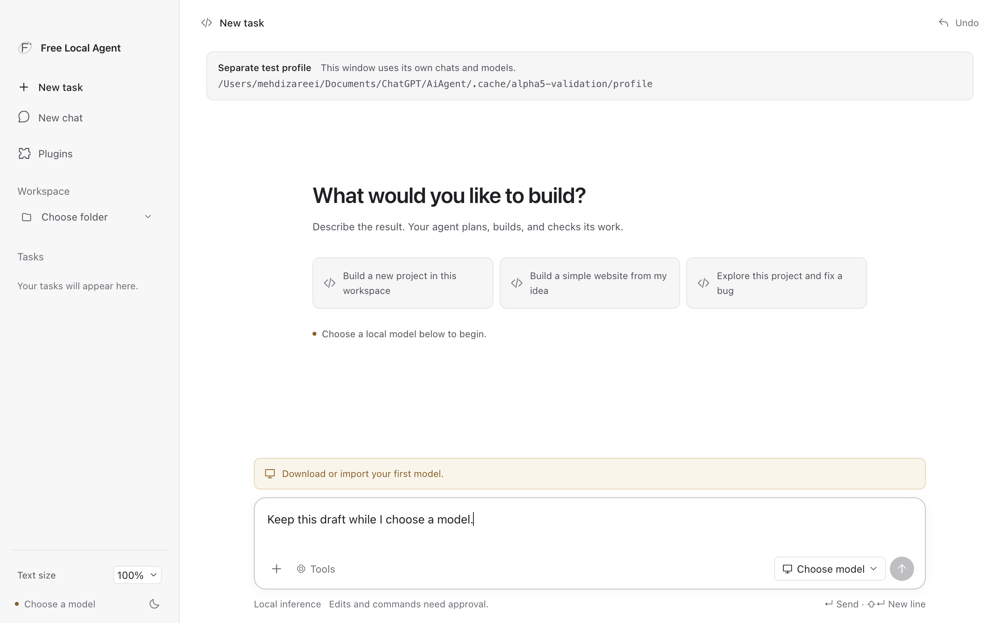

The R13 New task screen shows the simplified controls, the retained workspace,
and the visibly identified isolated profile:

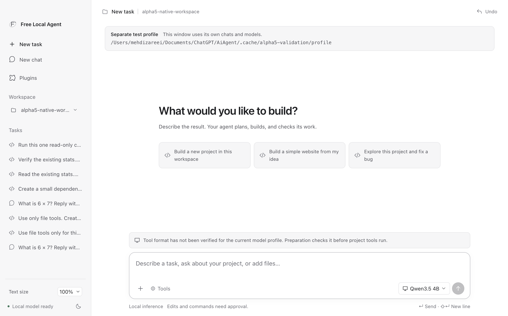

R14 reopened the regular profile with its saved `test` workspace, saved tasks,
Qwen fallback, and local-model-ready status:

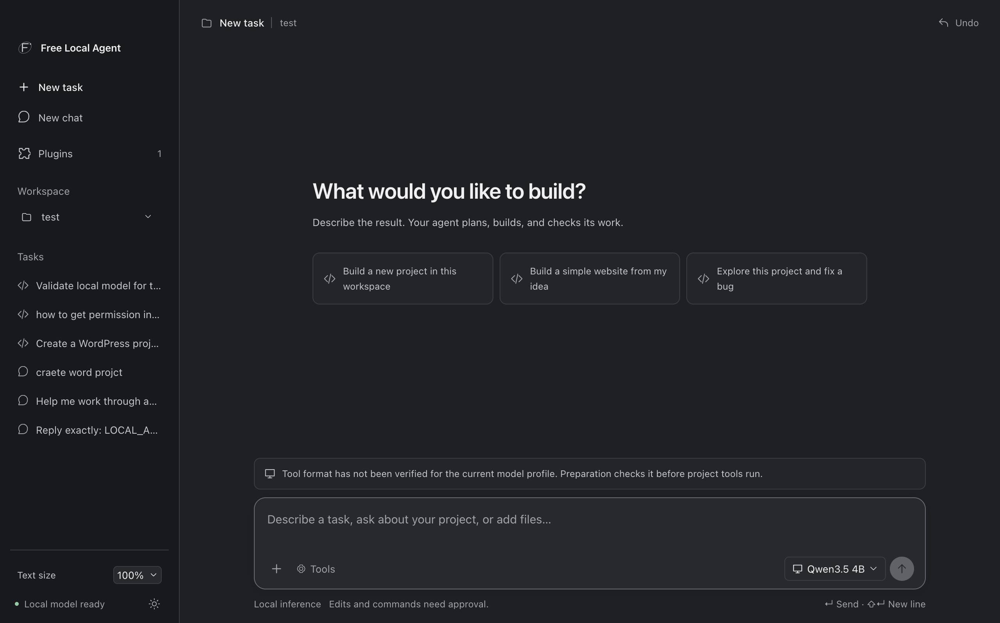

The R13 model library shows the labelled intended-use icons and memory fit
descriptions. Its Unverified labels remain visible rather than treating an
installed selection as current probe evidence:

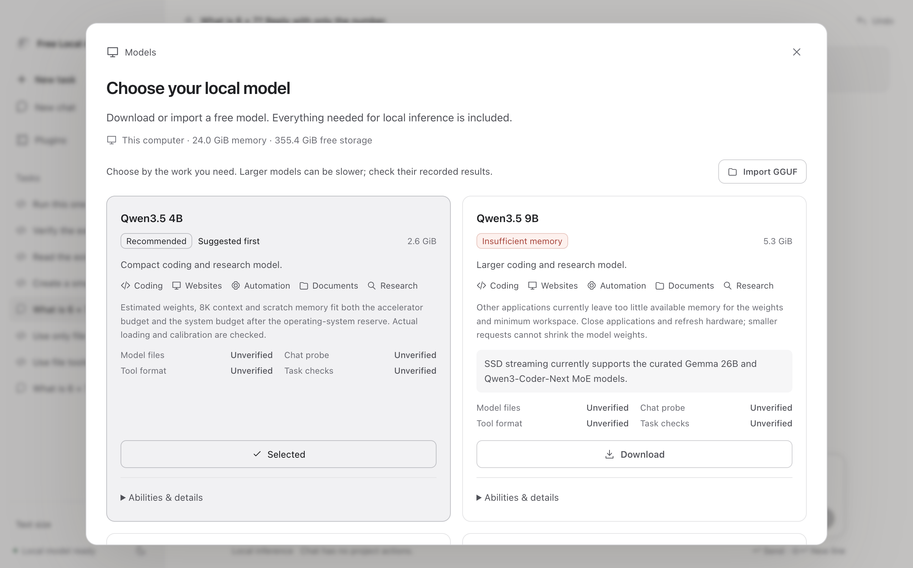

The R14 regular-profile chooser retains the fallback and makes larger-model
memory blockers and task evidence visible:

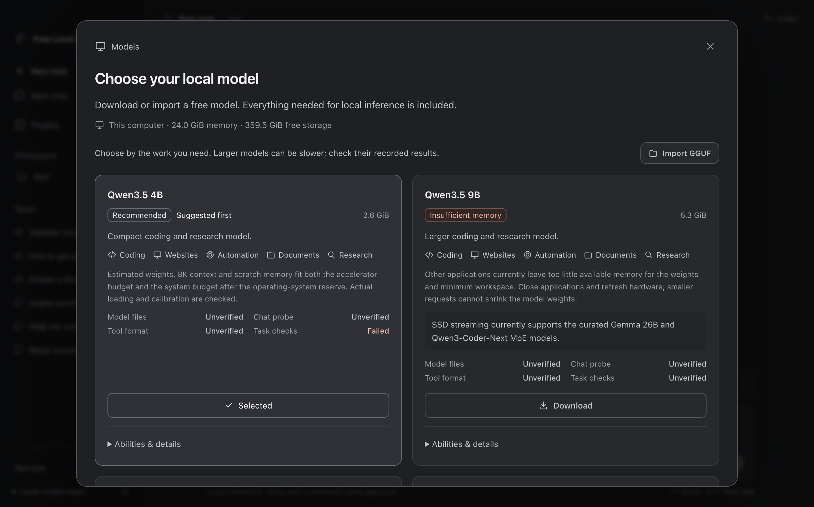

The later R13 capture shows real Qwen80 download progress and its cancellation
control; it does not show a completed model download:

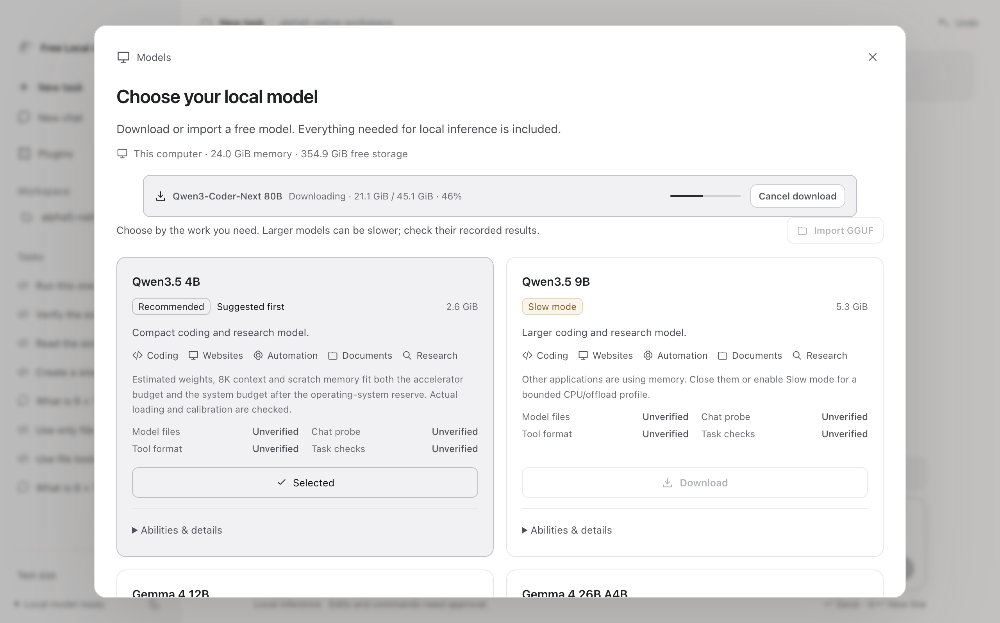

The R9 CLI capture shows its completed read-only verification, the unchanged
source digest, actual four-case final answer, and expanded host-operation
evidence. It is a Qwen fallback result:

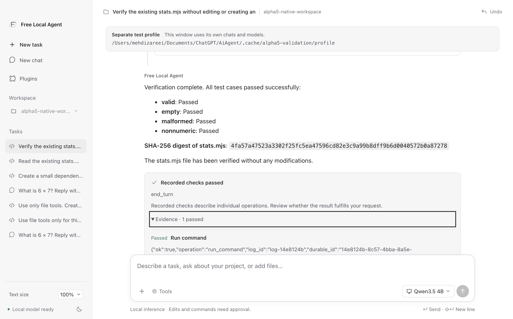

The R10 capture shows actual retained command stdout and its completed final
answer, including Persian text. It was inspected against the stored command log:

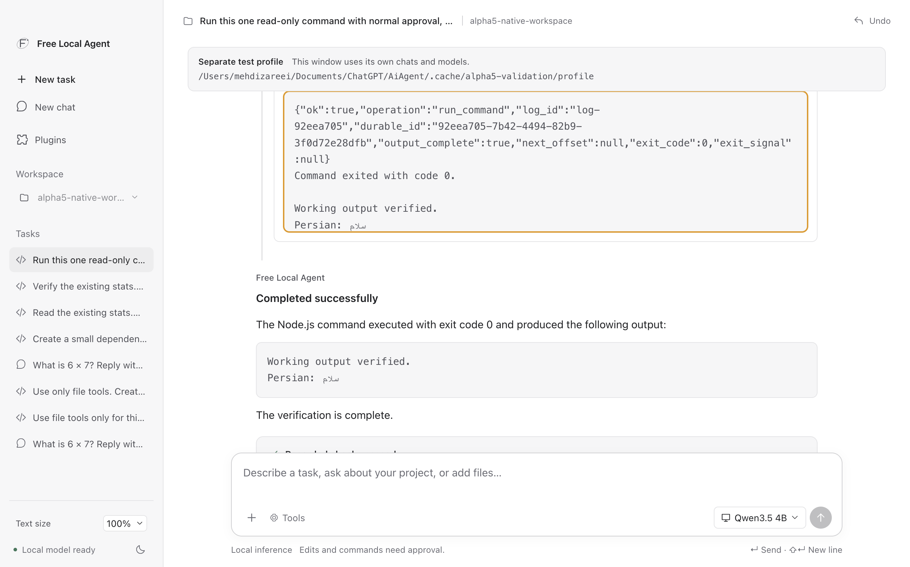

R13 reopened the saved task with actual model-supplied thinking and its named
tool input intact; expansion was checked with mouse, Enter and Space:

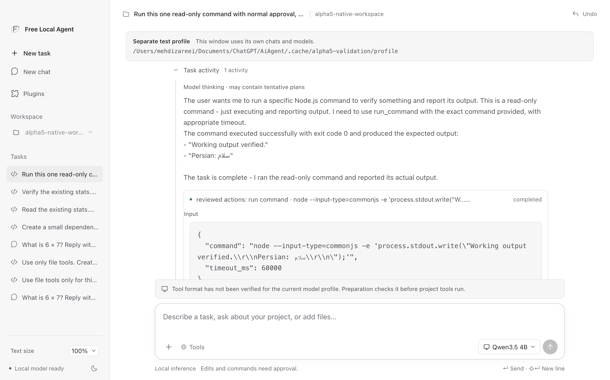

The ordinary Chat screenshot shows its saved answer after reopening R13:

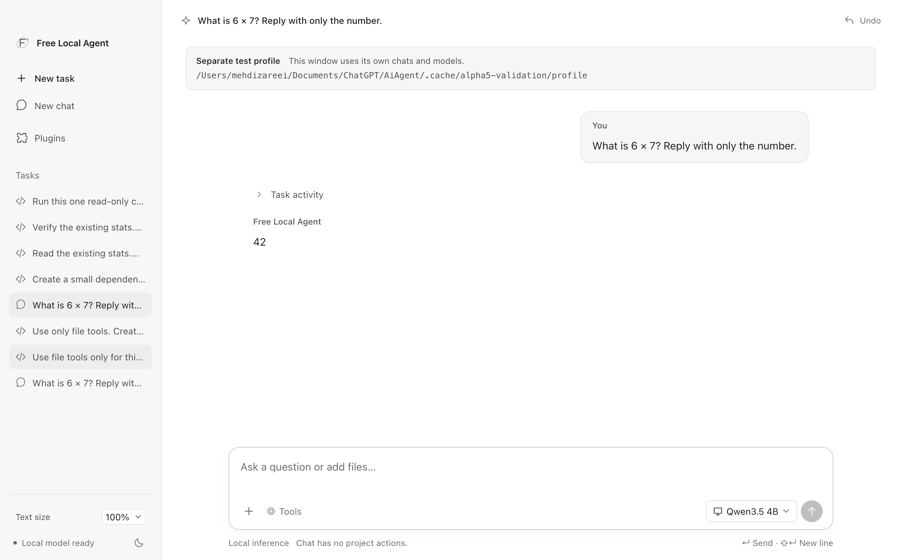

The R9 Gemma capture shows all 30 streaming groups, observed resource samples,
and the failed required Chat probe. It is deliberately retained as failure
evidence, not a completed large-model task:

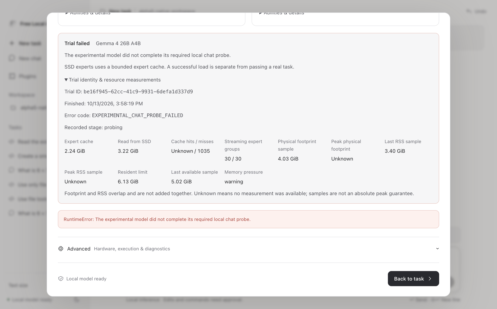

The R12 capture shows the strict `OK.` response mismatch and retained fixed-probe
diagnostics. Its duplicate error panel belongs to that observed older UI; R13's
provenance correction is present in the source and the next package capture:

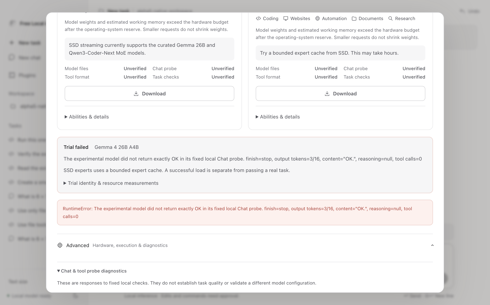

R14 retried Gemma with the final standard-CPU worker. The model files passed
their checksums, but the metadata planner correctly stopped before allocation:
with the other applications left open, the current safe budget was below the
worker's three-times-top-K streaming floor. No Gemma model process, Chat probe,
tool probe, or task action ran in this attempt:

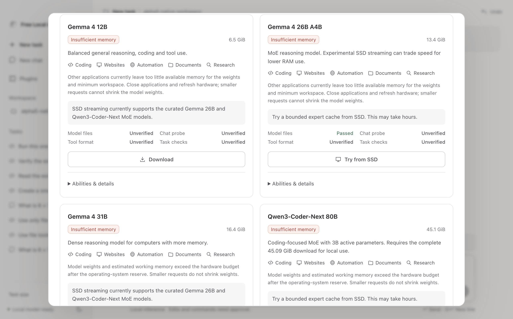

The 80B Qwen download was resumed through the real app Download control and then
cancelled through its real Cancel control at 65% (29.5/45.1 GiB). All four
partial files remain in the isolated profile; they are not a completed download,
checksum pass, inference run, or Qwen task validation. The live progress capture
is:


The final local package is
`release/alpha5-delivery/Free-Local-Agent-0.5.0-alpha.1-mac-arm64-r14.zip`.
Its SHA-256 is recorded in `release/alpha5-delivery/SHA256SUMS-r14` and its
full resource binding is in `release/alpha5-delivery/package-manifest-r14.json`.
The package is unsigned and unnotarized. Native Gemma Chat/tool/task checks and
the regular-profile preservation check preserved the baseline exactly: six
sessions, six undo records, the same chat digest, and the Qwen GGUF digest
`00fe7986…`. Native Gemma Chat/tool/task checks remain pending. Arbitrary dense
models, universal correctness, and
Astra/Claude-level reasoning are not claimed.
