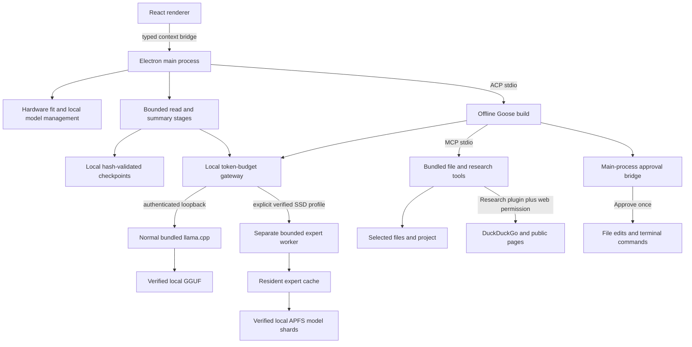

# Architecture and trust boundaries

Free Local Agent 0.5.0-alpha.1 uses a custom Electron/React desktop, the Goose v1.53.0 agent
engine, a bundled llama.cpp server, and a native research/file sidecar. Goose is
built from the vendored source with default features disabled and only
`rustls-tls,disable-update`; online model metadata and telemetry features are not
included. Source and binary hashes are recorded in resource manifests. No model
weights are bundled.

## Desktop workspace

The desktop has one primary **New task** workflow and a separate **New chat**
action. Planning, implementation, checking, and repair happen automatically.
Execution overrides, memory controls, calibration, and diagnostics live under
Advanced. One Workspace control offers Choose folder and Create folder; one
Models button opens cards before hardware details. Native fonts and shared tokens
set conversation/composer text to 15 px, code/thinking to 14 px, and controls to
13 px, with persisted 90–125% scaling.

Research activation and web permission live in Plugins; the composer has no
duplicate Research toggle. **Find files & text** means local workspace search and
retains the existing `projectSearch` preference. Legacy saved Agent, Chat, and
research sessions retain their behavior. This interface does not imply equivalent
model quality to any hosted product.

## Inference and model fit

The renderer has no Node integration or direct inference/network API. Main-process
IPC validates user operations; models cannot choose IPC methods, executable paths,
arbitrary providers, or tool permissions. Raw HTML is not rendered and renderer
connections are blocked by CSP. External links open in the system browser.

The bundled engine is pinned llama.cpp v0.6.0/build 11429, with official binary
archive SHA-256 values, license text hashes, and a full regular-file inventory.
Native validation checks its version and required offline/control flags. Packaging
preserves the inference manifest and validates the actual bundled resources.
macOS uses Metal or CPU; Windows/Linux include Vulkan and CPU backends. System GPU
drivers remain external dependencies. Windows preparation includes signed Visual
Studio redistributable runtime DLLs, and Ubuntu packages declare required runtime
libraries, including `libc6 >= 2.34` and `libstdc++6 >= 12` (GLIBCXX 3.4.30).
These version floors match the audited executable and bundled native libraries.
The app owns its loopback inference child and does not use Ollama.

Desktop status carries the runtime state and error code, model-discovery errors,
and storage profile identity with app-data and model-cache paths. Runtime readiness
means the bundled engine initialized; it does not imply that model weights exist
or that inference has loaded them. First launch with no weights is model onboarding,
and engine initialization is shown as a preparation state. Real engine and cache
inspection failures keep actionable errors. Status snapshots use the latest engine
state after asynchronous discovery; the renderer accepts only its latest status
request so older responses cannot overwrite newer readiness.

Model verification precedes task persistence and turn/tool construction. Missing
weights do not become an engine failure. Failed inspection refreshes status, and
known integrity failures block the affected catalog row rather than marking
unrelated models invalid. Curated rows offer a verified replacement download;
imported rows recover through GGUF import. Successful verification clears that
row's failure and stale recoverable model errors in an initialized runtime,
without clearing genuine engine errors or restarting inference. Choosing a usable
model enables sending in the current window. The renderer retains the draft and
attachments after rejected preflight, and setup never replays a task or its actions.

Hardware detection combines system memory, available memory, CPU/GPU information,
and free storage. Working-memory estimates reserve room for the operating system
and classify models as recommended, slow, or insufficient. Slow mode permits a
bounded CPU/offload profile; it does not shrink weights or permit a model beyond
the hardware budget. A small active-parameter count in an expert model still
requires the complete verified stored weights. The separate SSD route changes
resident placement, while preserving those weights and every selected expert. The four-bit catalog variants lower weight precision
to reduce storage and memory, with a quality tradeoff. Read stages reduce context,
not weight memory. Calibration checks native tool calling and measures this
computer's generation speed; task quality remains a separate manual evaluation.
Model cards disclose weight, 8K-context, scratch, operating-system reserve, and
system/GPU budget components. The loaded profile reports its actual context
capacity; these components remain estimates rather than observed peak memory.

Curated downloads use pinned publisher revisions and per-artifact SHA-256 values,
bounded approved artifact hosts, resumable partial files, and verified completion
before activation. Download blockers concern disk/integrity/acquisition; ordinary
use blockers separately concern available memory and template/backend support.
Qwen3-Coder-Next has four required pinned shards. All parts, their ordering, split
metadata, total size, and hashes are verified before use; curated split imports
require selecting the exact complete file set. GGUF import hashes the local file and validates bounded metadata,
architecture, and embedded chat template; unsupported variants can be rejected.
Imported models have their own publisher/license responsibility and start as
chat-only models. Native template support and a passing local tool-call probe are
required before tool use is enabled. A curated model's declared capability is
also provisional until its native template and calibration pass; a failed probe
leaves chat available with agent tools disabled. Runtime calibration results are scoped to the loaded session/profile. Persisted
task validation and SSD consent are separately bound to actual weights, template,
engine inventory, and profile. Stored consent requires fresh preparation; it is
not a loaded-model readiness claim.
Inference is local and offline. First catalogue downloads require the internet;
copying an imported local GGUF does not. Explicitly enabled web tools are separate.

## Experimental SSD worker

The app retains the normal engine and fallback model. The separate worker
backports routed-expert streaming and waved prefill from commits
`4260e460832f5e95c41d8b6d8b2aea98007df524` and
`db5268ffac4c3ddacd7edcf62e78e3a1ba8d8191` onto the pinned base. Its tracked patch,
build script, full native inventory, retained licenses, and synthetic provenance
are separate resources. The upstream proposal is unmerged; this is an experimental
app-specific build. See [worker notes](../scripts/ssd-inference/BUILD.md).

Attention, routers, shared experts, context/recurrent state, and working buffers
remain resident. Cold routed experts are read into bounded per-layer caches.
Read/upload completion precedes publication of a usable entry; failed uploads,
cancelled waits, and incomplete reads cannot publish resident entries. Wave masks
partition prefill computation while every selected expert is evaluated with its
original quantized values. All expected routed groups must confirm streaming;
silent full-model fallback is rejected. Gemma requires 24 slots/layer and Qwen 30.
Only descriptor-local Darwin cache bypass on a local APFS volume is accepted.

One model/context/slot, 4K context, 1K output allowance, batch 64, microbatch 16,
F16 context cache, and two I/O workers bound the initial profile. CPU is the
baseline. Production Metal selection requires a manifest-covered numerical and
real-task validation record for the exact model/template/engine/profile; trusted
isolated QA overrides cannot persist successful production consent. Backends
never switch during a task. macOS 14+ ARM64 is required; other systems retain the
normal engine.

Before a trial, main guards active work and unloads its preceding owned model.
The resident stop threshold is below `min(total RAM − OS reserve, available RAM −
1 GiB)`, with additional process headroom deducted for allocation. OS reserve is
at least 2 GiB or 20% of RAM. The native ledger separately guards dense weights,
cache, context/recurrent state, graphs, staging/uploads, output/arenas, and
reserved overhead before major allocations. Footprint and RSS are measured
independently, never summed as unified memory. Two-second monitoring is serialized;
missing monitoring, unsafe memory/pressure, deadlines, and cancellation stop the
owned worker. These are sampled protections, not an instantaneous OS memory cap.

Loading and shared probes each allow 30 minutes. Authenticated short control
requests arm the remaining deadline for each inference, and response completion
or idle approval waits disarm it. Local HTTP streaming avoids an implicit
five-minute transport limit; health, metadata and token-count requests stay short.
The trusted fatal-worker event aborts its task and settles pending approvals
before another action can execute. A worker stop cannot authorize action replay.
Failure/cancellation restores the preceding usable configuration and preserves
drafts; activation requires matching model digest, template, profile, engine,
Chat and tool probes. Old mmap results cannot validate this worker.

## Model thinking and working activity

The native engine extracts supported model thoughts into `reasoning_content`
separately from the final response. Goose forwards those as ACP thought chunks;
the desktop displays them in an expandable **Working** disclosure together with
current tool and stage activity. Up to 64 KiB of supplied thoughts per reply are
saved as a separate chat field, including partial interrupted replies. Only
answer content enters subsequent conversation prompts and compaction. Models
that provide no thought text show an explicit unavailable state; the app does
not manufacture thinking text. Named tool activity is saved with its assistant
exchange, including supplied inputs/results and execution status, and restored
when a chat is reopened. Records retain up to 256 calls and 16 KiB each for
input/output, with truncation notices. Later updates keep the original name
and input when omitted; unfinished calls become interrupted at turn completion.
These bounded display records never drive execution or replay. Processing-stage
progress remains transient UI state.
The disclosure keeps its expansion through streaming updates and shows the active
tool or approval state instead of a stale preparation stage. Conversation following
pauses while Working is expanded or the reader scrolls away from the bottom.
Tool disclosures expose their supplied inputs, outputs, and execution status;
approvals remain separate main-process decisions.

## Workspace selection

**Choose folder** uses a native existing-directory picker. **Create folder** accepts
a validated single folder name and opens a native parent-directory picker. On
macOS both pickers explicitly clear native file-type restrictions while keeping
`openDirectory`, so their selection remains folder-only. The
host creates one new child with nonrecursive `mkdir`, checks canonical paths and
directory identities, saves the selection, and then grants access to that child.
An existing file or directory is never overwritten. Cancelling leaves selection
and grants unchanged; saving failure restores the previous workspace and leaves
the new folder untouched. Picker and save operations block concurrent requests.
Saved tasks retain their own folder; changing it requires a new task.

## Context, stages, and resume

A local gateway serializes model calls and asks the engine to count the templated
input tokens. It reserves output capacity and a safety margin. Older completed
conversation and completed read-only activity can be summarized locally to make
space, including earlier reads within the current turn. Eligible reads are an
allowlist of app-owned file/PDF inspection, listing, search, and saved-command-log
tools with uniquely paired, complete call/results. Unknown tools, ambiguous or
partial batches, and the latest tool group remain exact. Summaries retain exact
read-call IDs, arguments, and bounded source locations alongside lossy findings.

System instructions, the current user request, tool schemas, all command/edit
calls and results, and pending tool exchanges are retained exactly. Compaction
does not execute tools or restart a turn. Its local summarization work is bounded;
if the retained context still does not fit, the task reports a smaller-request
path rather than silently removing action history. Allocation failures have a
bounded lower-profile inference retry; this is not a guarantee that a large
model can load.

Attached text/PDF sources are inspected for hashes, then read using bounded
continuation cursors, including long lines and long PDF pages. Each excerpt is
summarized with source locations, and summaries are reduced sequentially before
agent execution. Large pasted requests also use bounded stages. These summaries
are lossy; exact facts may require additional reads from the original source.

Checkpoints persist the request, model digest, source hashes, read cursors, summary
progress, and phase in application data. Pause/restart can resume **read-only**
stages only after validating those identities. Changed sources/models invalidate
old summaries and restart reading. Agent action phases cannot resume or replay
edits and commands automatically. An interrupted agent turn needs a new request.

The app keeps full displayed transcripts locally. Each turn starts a fresh Goose
ACP session using temporary backend configuration, cleaned after the turn. Recent
conversation context is bounded; seeing an old message in the UI does not imply
that all of its detail is in the next inference request. Stage checkpoints and
edit snapshots are independent durable app data, not a resumed Goose database.

## Tool preferences and action review

The user chooses file reading, **Find files & text**, file editing, and terminal in
**Tools**. The **Plugins** page separately stores **Enable Research** and
**Allow web research**. **Both research settings default to false.** Disabled tools
are omitted from the
MCP tool list, including network tools. Modes and model tool support further
constrain the offered capabilities. File reading works in every mode, project
search/editing/terminal only in Agent, and web tools in Agent and Read-only research
only when the plugin and web permission are enabled and the model's tool support
has been validated. Local Agent tools do not depend on the Research plugin.
Chat never registers network tools, including when a saved preference
is true; the sidecar enforces that mode boundary too. A chat-only
model still uses enabled read stages for attachments but bypasses Goose and agent
tools for the final response. The research sidecar exposes `inspect_file`
alongside enabled file reads; inspection returns a hash/size, not document text.

Agent and Research turns load the app-owned `task-research/SKILL.md` from the
packaged ASAR before starting Goose **only when Research is enabled**. The loader
validates identity and size;
external Goose skill discovery remains disabled. These instructions guide
version-aware primary-source research, bounded findings, and implementation
with the existing approval tools. The complete skill enters native token counting
alongside the request and tool schemas. Web-disabled turns cannot register web
tools, and the skill forbids network research workarounds. Disabling the plugin
omits its instructions and web tools even if web permission remains saved. A
disabled plugin's missing assets do not block ordinary Agent startup; an enabled
plugin with missing assets fails before Goose launches. The backend independently
filters web registration so a raw web preference cannot bypass plugin gating.
The shipped Research plugin is app-owned; this is not an arbitrary external
plugin installer. Chat-only imports
receive local-context instructions and never advertise tools they cannot call.

General Agent instructions require prerequisite/version inspection, implementation,
appropriate validation, and repair of observed failures using the offered tools
and approvals. Empty workspaces are supported. The agent must report tool-backed
outcomes and precise observed blockers, respect denied actions, and avoid replaying
completed commands or edits. WordPress is a task-verification example, with no
dedicated generator, tool, or policy branch.

Saved state version 5 persists plugin/web preferences, task budgets, text scale,
and execution settings independently. Missing
plugin settings in version 1/2 or unversioned legacy stores preserve prior explicit
web consent by enabling Research during migration. Missing plugin settings in a
version 3 or later store default off. Explicit saved plugin choices always win, including
false with web consent true. Migration preserves conversations, attachments,
model selection, project paths, and the existing model and undo stores. Settings
changes are rejected while a task is running; failed persistence restores the
previous preferences.

Edits and commands require a decision for each pending action in main. The UI shows
arguments and a diff or command. Denial leaves the action unexecuted; approval
applies once. Unknown/consumed requests cannot grant later access. Writes are
bounded to the selected project and have pre-edit snapshots. Saved coding chats
restore their per-chat undo history.

New tasks use the bounded Plan → Implement → Verify → Repair → Final policy,
with 40 model steps and three repair cycles. Standard remains an Advanced
compatibility override. Task budgets freeze at creation: normal/migrated tasks
retain one hour, new SSD tasks get four or eight active hours. Approval waits
pause the active clock without extending approval expiry. Remaining time and
cancellation propagate through preparation, stages, compaction, native inference,
Goose transport and shutdown. Expiry records evidence and needs explicit
continuation; no agent turn is automatically replayed.

Exact UTF-8 file text is separate from line/location metadata. Mutation results
state changed/unchanged and the verified digest; edit arguments are never silently
stripped of prefixes. Two identical failed edits against unchanged input stop
that loop. Backend completion reasons become completed, blocked, cancelled,
timed-out or incomplete outcomes. If a non-cancelled turn returns no answer,
at most one bounded tools-disabled finalization can describe retained evidence.
Checks are Passed/Failed/Unverified based on readbacks or command results rather
than the model's success claim.

Each proposed command includes its execution time limit in the reviewed arguments.
The default is `timeout_ms: 60000`; an explicit integer from 100 to 600000 ms
permits longer dependency work, with a maximum of ten minutes. The native command
bridge and Goose reviewed-action extension have a 1500-second request deadline
so approval review and a permitted long command fit within the transport budget.
Other native reviewed-action requests have a 900-second deadline; the separate
read/research sidecar retains its own limits. These request deadlines do not
extend the approved command's execution limit. Pending approval still expires
after ten minutes. Disconnect, cancellation, timeout, or an unconfirmed action
result stops the agent turn, records interruption where applicable, and never
automatically repeats completed or partially executed work. Command logs remain
available through paged read-only excerpts.

**Terminal commands are not OS sandboxed.** An approved command runs as the user's
account; its project working directory does not constrain access to other files,
subprocesses, or networks. Read/write grants do not constrain approved commands.
Undo cannot reverse command side effects or concurrent changes by other programs.

## Read, network, and storage boundaries

Selected files grant those exact files; project grants allow bounded traversal
below their canonical root. Reads deny parent traversal, symlink/junction escapes,
common credentials, and credential directories. These checks are not a complete
secret scanner and do not isolate another program running as the same OS user.
PDF extraction runs in a cancellable resource-limited worker; scanned/encrypted
PDFs and Office formats remain unsupported. See the
[sidecar contract](../local-agent/research/README.md) for exact size/time limits.

Enabled research sends queries to DuckDuckGo and requests public pages. Fetching
validates public DNS answers and redirects, disallows credentialed/private URLs,
and bounds response sizes/time. It does not execute JavaScript or carry browser
cookies. Documents and pages are untrusted data; their instructions cannot grant
tool permissions. External links, model downloads, and approved commands can also
use the network even though inference stays local.

Web results record tool-generated UTC observation timestamps separately from
publisher/server date claims. Fetches retain the requested and final URLs, a
SHA-256 of normalized source text, and bounded unverified metadata. A declared
canonical URL never replaces the fetched citation URL or initiates a request.
Metadata and excerpts share the serialized tool-result budget; pagination offsets
reflect the excerpt actually returned. A hash change between pages signals a
changed source. Search snippets provide discovery rather than verified releases.

Chats, model files, imported-model records, checkpoint excerpts/summaries, and edit
snapshots persist in the app's userData directory. The app adds no disk encryption.
Users should grant only material they intend the local model to process and rely
on operating-system account/storage protection for local data.
The normal profile retains the legacy `Local Agent` application-data name across
the public rename, preserving weights, chats, grants, and undo records. An explicit
`--user-data-dir` resolves to an independent profile with visible storage identity.
No automatic copying or merging occurs between regular and test profiles.

## Validation and distribution

Tests of fake providers and mocked networks establish protocol/permission behavior,
not actual model competence, GPU allocation, or complete-agent speed. Native
resource smoke tests validate pinned offline manifests, engine version, packaged
MCP controls, and denied writes without loading an LLM or contacting a public site.
See the [alpha.5 model/package report](alpha5-validation.md),
[current verification status](build-verification.md), the
[Working/folder record](working-folders-validation.md), the previous
[workspace and plugin record](workspace-plugin-validation.md), and the
[real-model rubric](alpha-validation.md).

macOS arm64 ZIP, Windows x64 portable ZIP, and Ubuntu x64 DEB jobs are configured.
Windows/Linux native jobs have not been executed locally. The macOS app is unsigned
and not notarized; alpha packages use manual updates and artifact checksums. CI has
read-only permissions and does not publish releases or hold signing credentials.
